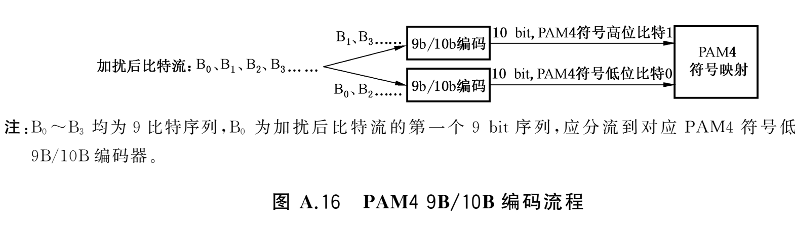

# 车载万兆 PCS：物理层处理流程（正向 / 反向）

> **范围**：QC/T 1217—2024 的 A.2.1 处理流程、A.2.2 正向链、A.2.3 反向链、A.2.4 物理层优先级传输。
>
> **本文不含 RS-FEC 算法本体**（生成多项式、系统码编码、伴随式、BM/Chien/Forney、失败判据、RTL 口径）——
> 那部分见 [算法规格.md](算法规格.md)（定稿正文）与 [FEC原理与RTL实现.md](FEC原理与RTL实现.md)（推导长文）。本文只用到 FEC 的**参数**：
> 正向 RS(384,354,9)（t=15，本原多项式 x⁹+x⁴+1）、反向 RS(73,69,8)（t=2，x⁸+x⁴+x³+x²+1）、交织深度 L。
>
> **与标准解耦**：每章只在标题下用一行"依据"给出本段对应的条款、表 / 图编号与页；正文内部**不带条款号、
> 也不带表 / 图编号**，内容按图、表、字段原样复述（写全，不写"接第 x 条"）。需要回查原文时按"依据"行去看。
>
> **素材基线**：国标原文 PDF 124 页（本机 `Downloads\车载chezaichezhai.pdf`）；**PDF 页 = 印刷页 + 8**。
> 中文原文按 PDFium 抽取（`pdftotext` 抽不出该 PDF 的中文，见技能 `standards-doc-to-skill`），
> 全文语料 `%LOCALAPPDATA%\Temp\pcs_pdf\work\full_text.txt`（带 `===== PAGE N =====` 标记）。
> **已对着原图核对过的图**：图 A.9（总流程）、图 A.13（交织）、图 A.15（正向扰码器）、图 A.16（PAM4 9B/10B）、
> 图 A.18（CRC 寄存器）、图 A.22（优先级传输）。
>
> **标记约定**：正式文档 = 复述协议本身 + 每章末尾的 `### 建议（由你定夺）`。建议是 Agent 在答完本章提问、
> 整理完笔记之后主动提出的"**可能影响 RTL 编写的重点**"清单（需要先定死的参数、实现取舍、易踩的坑），**待使用者判断**；
> 使用者给出意见后**改完直接并入正文、不再回问**，该章建议段随之删除。 `[待核]` = 必须目视原图/表才能定（清单见 §0）。
>
> **相关文件**（资料导航，不属正文）：
> - RS-FEC 算法本体 / 失败判据 / RTL 口径：[算法规格.md](算法规格.md)（正文）+ [FEC原理与RTL实现.md](FEC原理与RTL实现.md)（推导）
> - 工程实现脚本（本仓库 `code/`）：[crc.py](../code/crc.py)（CRC 串行 + 并行，互相验证）、[crc_mask_gen.py](../code/crc_mask_gen.py)（并行 CRC 常数表生成器，K 与 CRC 可自选）、[scrambler_parallel.py](../code/scrambler_parallel.py)（并行加扰常数掩码 / 滚动窗口）
> - 问题追踪、待确认、问答索引：`questions_pcs.md`；工程复现基准：`README.md`
> - 国标中文抽取器：`skills/research/standards-doc-to-skill/scripts/pdf_helper.py`，解释器 `hermes\venvs\pdf-tools\Scripts\python.exe`
> - 本文件目录行号重算：`skills\software-development\qct1217-pcs-fec\scripts\md_toc.py`；逐章推进的约定见该技能的 `references/推进流程.md`
>
> **尚未展开的章节**（注释用，不属正文；逐章推进时再展开。PDF 页 = 印刷页 + 8）：
> - A.2.2.3 / A.2.3.3 正向 / 反向 RS-FEC 编码：算法本体只给链接 —— [算法规格.md](算法规格.md)（正文）、[FEC原理与RTL实现.md](FEC原理与RTL实现.md)（推导）
> - A.2.5 物理层重传：正向重传 A.2.5.1（PDF p31）、反向重传 A.2.5.2（p32）—— 本文只在 §9.3 与 §0-9 引用其判据，条款本身未展开
> - A.2.6 控制消息（PDF p33~35）：控制消息格式（表 A.8）、正向 / 反向物理层重传消息（表 A.9 / A.10）、链路重建消息（表 A.11）、休眠控制消息（表 A.12）
> - A.2.7 控制帧（PDF p36~41）：
>   · 链路协商帧 A.2.7.1（表 A.13~A.15、加扰图 A.25）
>   · **链路训练帧 A.2.7.2**（格式图 A.26、加扰图 A.27、表 A.16 / A.17，PDF p38~40）—— 本文只作介绍（见 §1），格式后文展开；
>     其中"数据域传输 PLDB 数量"与"交织深度"就是 §5 / §4 引用到的字段
>   · 同步帧 A.2.7.3（本文 §5 已覆盖）、休眠心跳帧 A.2.7.4
> - A.2.8 信号电气指标（PDF p42~46）：摆幅和眼图、功率谱密度、最大输出顶降、时钟频偏、时钟抖动
> - A.2.9 码表（PDF p47~71）：9B/10B 码表（A.2.9.1）、8B/10B 码表（A.2.9.2）—— 本文 §7 已给结论，全表尚未目视校完（§0-7）
>
> **书写约定**：**一段/一条写成一行，不要手工折行** —— 续行若以 `+`、`-`、`*`、`1.` 等开头会被 Markdown 当成新块，
> 预览里就会出现"莫名其妙的分段"。长行交给编辑器软换行即可。
>
> **记录格式的硬要求**：凡描述码块 / 帧 / 字段的格式，**第一句先写"怎么发送"**（从哪一端开始：控制端 / 码块端 /
> 指示位端；比特与块的方向），再写字段划分与比特区间。这是最容易出错的位置。
>
> **Agent 导航**：勿整文件逐行读入。按「目录」行号跳章节；行号对不上时先跑 `md_toc.py --check`。

<!-- toc-exclude: ^建议 -->

## 目录
> 行号随编辑漂移，最后更新：2026-10-15。

| 章节 | 起始行 | 结束行 |
|---|----|----|
| 0. 待核对清单（均需目视原图/表） | 75 | 95 |
| 1. 物理层处理流程 | 96 | 150 |
| 2. 64B/66B 编码 | 151 | 188 |
| 3. PLDB 组帧 | 189 | 240 |
| 4. RS 码元交织与 RX 解交织 | 241 | 255 |
| 5. 传输帧与同步帧 | 256 | 292 |
| 6. 数据域加扰与各帧的加扰范围 | 293 | 371 |
| 7. 9B/10B 与 8B/10B 编码 | 372 | 409 |
| 8. 符号映射 | 410 | 428 |
| 9. 校验分层与 CRC 口径 | 429 | 563 |
| 　9.1 生成多项式与寄存器结构 | 435 | 454 |
| 　9.2 计算流程与位序口径 | 455 | 480 |
| 　9.3 各处的 CRC 分工与覆盖范围 | 481 | 530 |
| 　9.4 并行实现（一拍 K bit） | 531 | 555 |
| 　9.5 三个必须验的边界（都用本机脚本实测过） | 556 | 563 |
| 10. 物理层优先级传输 | 564 | 579 |
| 11. 一条完整数据流的账（正向 / 反向） | 580 | 606 |
| 附录 A　码表（9B/10B 与 8B/10B） | 607 | 1419 |

## 0. 待核对清单（均需目视原图/表）

| # | 对象 | 位置 | 状态 / 影响 |
|---|---|---|---|
| 1 | 图 A.10 66B 码块格式：指示位 / 子指示位的**位序与高低位画法** | p24 | 待核；RX 位映射（`[1:0]` 是低 2 位已由正文明确） |
| 2 | ~~图 A.11 / A.17 PLDB 格式：控制、净荷、CRC 的左右顺序~~ | p25 / p28 | **已核（2026-10-14）**：图 A.11 = "正向 PLDB 控制 \| 正向 PLDB 净荷"（控制左、净荷右）；图 A.17 = "反向 PLDB 控制 \| 反向 PLDB 净荷 \| 反向 PLDB CRC"（控制左、CRC 右）⇒ 与"控制在前、CRC 最后"一致。剩余口径：框图的左→右是**段顺序**、不是比特序记法（见 §3 建议 1 末条） |
| 3 | ~~图 A.13 交织输出码元序~~ | p26 | **已核（2026-10-13）**：位置优先成组、D0 先发 ⇒ open 0.22 关闭，见 §4 |
| 4 | 图 A.15 / A.21 扰码器：**图上抽头位置**与公式 A.4 / A.7 的指数不对应 | p27 / p30 | **已核（2026-10-15）**：图 A.15（正向）抽头 = `Scr[12]` + 右端 `Scr[32]`，图 A.21（反向）抽头 = `Scr[19]` + `Scr[32]`；按图读 ⇒ [12] 对应 x³³+x²⁰+1、[19] 对应 x³³+x¹³+1 ⇒ **两图与文本公式对调**（差 7）。必须与对端逐位比序列，或靠同步帧"扰码"字段在线校验（§6） |
| 5 | ~~图 A.16 PAM4 9B/10B 结构~~ | p27 | **已核（2026-10-14）**：**2 台**编码器（不是 4 台），偶数序列进"低位比特 0"那台、奇数序列进"高位比特 1"那台；B0~B3 是 9 bit 序列（§7） |
| 6 | ~~图 A.18 CRC 寄存器结构~~ | p29 | **已核（2026-10-14）**：右移 / 反射型，最左异或门只有两输入（数据 + C0 回线），输出即 fb；抽头位置 = 反射多项式中为 1 的位（§9） |
| 7 | 码表 A.2.9.1 / A.2.9.2 全表 | p47~63 / p63~71 | **已誊入附录 A**（行数 8 / 512 / 12 / 256 全齐，含页尾断行的第 364 行）；**全表目视校对未完成**；K 码与码字字母表结论见 §7 |
| 8 | ~~图 A.11 / A.14 正向 PLDB 与传输帧的净荷排列~~ | p25 / p27 | **已核（2026-10-14）**：图 A.14 / A.20 只画到**域级**（"同步域 + 数据域"两个子框、逐帧重复，同步域在前），图 A.11 / A.17 只画到**段级**（控制 \| 净荷 \| CRC）；码块顺序与 `11` 类插入不由图给出，按 §2 的指示位规则定 |
| 9 | **正向 PLDB "未被正确接收"的判定依据**（重传条款只写"未被正确接收"，未给判据） | p31 | 待核；重传触发条件，实现上应 = FEC 判据失败（判据定义见 [算法规格.md](算法规格.md)）或 PLDBID 不连续，待与基线 RTL 对账 |
| 10 | 表 A.17 的"反向重传字段"定义（支配表 A.6 的"数据类型"） | p38~39 | 待核；反向 PLDB 控制字段取值 |
| 11 | 扰码器 / 编码器在**帧边界的复位与初值**、**明文段（开始符）期间是否推进**（标准未规定） | — | 待定（当前按 [推论] 的"自由运行"实现，见 §6）；两端同步，联调前必须先定死 |
| 12 | **NRZ 挡位下的 9B/10B 结构**（图 A.16 只画了 PAM4 的比特面拆分） | p27 | 标准未画图；解读为"一路编码器、按 9 bit 顺序查表后 10 bit 顺序上线"（无歧义），与对端一致即可 |
| 13 | **物理层控制消息 CRC32（字节 4~7）的覆盖范围**（标准未明文） | p33~35 | 待核；当前按 [推论] = 消息内 CRC 之前的字段（字节 0~3），需与对端确认（§9.3） |
| 14 | **填充 PLDB 的净荷构成**、以及数据传输状态下**上行空闲是否也发填充 PLDB**（标准未明文） | p20、p25 | 待核；组帧器空闲行为（§3） |

---

## 1. 物理层处理流程

> 依据：A.2.1 物理层处理流程（图 A.9）；速率挡位见 5.3 传输速率（表 1 / 表 2）；位序总口径见 A.2 下的注。
> 挡位的协商与训练参数见链路协商 / 训练帧。PDF p3、p11、p23~24、p36~37、p39。

**7 条通路**（每条都写全，便于直接看出哪些处理块被共用）：

1. 正向媒体封装包 / 正向物理层控制消息 → 64B/66B 编码 → 正向 PLDB 组帧 → 正向 RS-FEC 编码 → RS 码元交织 → 正向传输组帧 → 正向加扰 → 9B/10B → 符号映射 → 按协商挡位发送
2. 正向同步帧 → 正向传输组帧 → 正向加扰 → 9B/10B → 符号映射 → 按协商挡位发送
3. 链路协商响应帧 → 正向加扰 → 8B/10B → NRZ 符号映射 → 正向挡位 1 发送
4. 正向链路训练帧 → 正向加扰 → 9B/10B → 符号映射 → 按协商挡位发送
5. 反向媒体封装包 / 反向物理层控制消息 → 64B/66B 编码 → 反向 PLDB 组帧 → 反向 RS-FEC 编码 → 反向传输组帧 → 反向加扰 → 8B/10B → 符号映射 → 反向挡位 1 发送
6. 反向同步帧 → 反向传输组帧 → 反向加扰 → 8B/10B → 符号映射 → 反向挡位 1 发送
7. 链路协商请求帧 / 链路协商结束帧 / 反向链路训练帧 / 休眠心跳帧 → 反向加扰 → 8B/10B → 符号映射 → 反向挡位 1 发送

**共用处理块**（图上这些块各画一份，多个通路汇入）：

- 正向"传输组帧 / 加扰 / 9B(8B)/10B / 符号映射"：正向数据链（第 1 条）与正向同步帧（第 2 条）都经过；正向加扰器因而同时服务数据域、同步帧、正向链路训练帧；协商响应帧（第 3 条）只借道加扰之后的 8B/10B 与 NRZ 映射。
- 反向"传输组帧 / 加扰 / 8B/10B / 符号映射"：反向数据链（第 5 条）与反向同步帧（第 6 条）都经过；协商与心跳类控制帧（第 7 条）只借道加扰之后的 8B/10B 与符号映射。

**要点**（按重要性排）：

1. **数据链与同步帧链共用**"传输组帧 / 加扰 / 编码 / 符号映射"这几个处理块 ⇒ 每个方向只需要**一套加扰器 + 一套编码器**，它们同时服务该方向的数据域、同步帧、链路训练帧与协商帧；代价是**帧间过渡时序要定死**（§6）。
2. **正向数据链比反向多一级**：正向有 RS-FEC(384,354,9) **和** RS 码元交织；反向有 RS-FEC(73,69,8) 但**没有交织**。
3. **分流点在传输组帧之前**：发送侧不是"选一条通路"而是**按帧类型分流**，接收侧要按域类型反向拆。只有"媒体封装包 / 物理层控制消息"这条链经过 PLDB 与 FEC；其余帧（正向同步帧 / 训练帧、协商响应帧、反向同步帧、协商 / 训练 / 心跳类控制帧）都不走 64B/66B、不走 FEC、不走交织，只从传输组帧（或加扰）开始接 ——这些控制帧的字段格式属控制帧章节，本文不展开。
4. **挡位**：正向数据按协商挡位；协商响应帧、协商请求 / 结束帧、反向链路训练帧、休眠心跳帧、反向数据链**固定挡位 1**。
5. **符号映射按挡位选**：挡位 1~5 用 NRZ；挡位 4a/5a/6 在训练阶段用 NRZ、之后用 PAM4（§8）。

**正向链路训练帧 / 反向链路训练帧（此处只做介绍，后文才展开）**：链路训练状态下正向 / 反向节点**连续发送**的帧，作用是让对端完成**扰码同步**与**收端权值收敛**，并携带训练结果与一批配置参数。它的格式与字段属控制帧章节，本文暂不展开；后文只在用到它的作用时点明 —— **数据域传输的 PLDB 数量**（§5）与**交织深度**（§4）都由它携带。

**FEC 相关的计算流程不在本文展开，只在这里给出入口**：RS 编解码链（系统码生成、伴随式、BM → Chien → Forney）、失败判据、RTL 口径见 [算法规格.md](算法规格.md)；原理、取舍与长推导见 [FEC原理与RTL实现.md](FEC原理与RTL实现.md)。本文只引用其**参数与调用位置**：正向 RS(384,354,9)、反向 RS(73,69,8)、交织深度 L。

**速率挡位（= "协商挡位"）**：挡位是标准规定的**物理层速率分档**（速率 + 调制方式 + 波特率三件套），上电后的链路协商阶段确定用哪一挡，随后按该挡位训练、再进入数据传输状态。

| 正向挡位 | 速率 | 调制方式 | 波特率 |
|---|---|---|---|
| 1 | 2 Gb/s | NRZ | 2 GS/s |
| 2 | 3.2 Gb/s | NRZ | 3.2 GS/s |
| 3 | 4 Gb/s | NRZ | 4 GS/s |
| 4 | 6.4 Gb/s | NRZ | 6.4 GS/s |
| 4a | 6.4 Gb/s | PAM4 | 3.2 GS/s |
| 5 | 8 Gb/s | NRZ | 8 GS/s |
| 5a | 8 Gb/s | PAM4 | 4 GS/s |
| 6 | 12.8 Gb/s | PAM4 | 6.4 GS/s |
| 反向挡位 1 | 100 Mb/s | NRZ | 100 MS/s |

- **必须支持**：正向挡位 1、2、3、4；可选挡位 4a、5、5a、6（若支持 8 Gb/s，应首先支持 5a，在此基础上可支持 5）。反向只有挡位 1。注：这里的"速率"指物理层传输速率。
- 带 **"a"** 的挡位 = 同速率改用 PAM4 ⇒ 波特率减半（4a 对 4、5a 对 5）。
- **挡位怎么协商出来**：协商帧里有"正向速率挡位"字段（取值 0~7 分别对应挡位 1、2、3、4、4a、5、5a、6）与 "反向速率挡位"字段（0 = 挡位 1，其余预留）；训练帧按挡位分别给出训练时长字段（0 = 不支持 / 不使用该挡位，1~63 表示支持、训练时长 = 4.608 ms × 该值），并携带交织深度、预加重挡位等运行参数。训练分 NRZ 训练与 PAM4 训练两个阶段（挡位 4a/5a/6 两段都走）。
- **挡位决定的下游参数**：符号映射（NRZ / PAM4，§8）、交织深度 L 的可选范围（§4）、同步帧发送间隔上限（§5）、时钟频率与训练时长、电气指标（眼图模板）等。

**位序总口径**：本文件定义的传输帧、控制消息、控制帧和媒体封装包均按**从最低比特到最高比特**的顺序传输；如无特殊说明，**比特 0 为低位比特**，序列中**最右的比特为最低位**。（示例类文字另有一套相反写法："靠左为低位比特"——用示例做回归向量时按那套，见 §9.2。）

---

## 2. 64B/66B 编码

> 依据：A.2.2.1 正向 64B/66B 编码、A.2.3.1 反向引用同一条；图 A.10、表 A.2 / A.3；位序见 A.2 下的注；
> 子指示位的取值来自 A.2.6.1（表 A.8）与 A.3.1（图 A.35 / A.36、公共头字段定义）。PDF p24~25、p28、p33、p73。

- **分片**：物理层把媒体封装包分割为 **1 个或多个 64 bit** 的分片（不是 64 字节）；每个分片编码成 **1 个 66B 码块**；同一媒体封装包的多个分片的码块**按分片顺序**传输。
- **发送顺序**：从码块的**最低比特**开始 —— 即**先发指示位 `[1:0]`**（其中 bit0 先出、bit1 后出），再发负荷的低位到高位（`11` 时负荷最先发的 4 bit 就是子指示位 `[5:2]`）。原因：整条链按最低位先传，而指示位在低 2 位。 **具体例子**：指示位写 `10`（最后一个分片）= bit1=1、bit0=0 ⇒ 线上**先发 0、再发 1**；写 `01`（第一个分片）= bit0=1 ⇒ 先发 1、再发 0。即"写法的左右"与"发送的先后"方向相反（最左 = 最高位 = 最后发）。
- **66B 码块 = 64 bit 负荷 + 2 bit 码块指示位**，指示位在**低 2 位**（`[1:0]`）。
- **指示位语义**：

| `[1:0]` | 含义 |
|---|---|
| `00` | 该码块负荷传输媒体封装包的**中间分片** |
| `01` | **第一个分片** |
| `10` | **最后一个分片** |
| `11` | 传输**物理层填充 / 物理层控制消息 / 媒体封装小包** |

- **`11` 时负荷的低 4 位是子指示位**：

| 子指示位 `[5:2]` | 含义 |
|---|---|
| `0000` | 物理层填充，**64 比特负荷全为 0** |
| `xyz0`（x、y、z 为 0 或 1，但不能全为 0） | 物理层控制消息，子指示位即该消息的**低 4 位比特** |
| `xyz1`（x、y、z 为 0 或 1） | **媒体封装小包**（不超过 8 个字节的媒体封装包），子指示位为对应媒体封装包的低 4 位比特 |

- **子指示位不是自由标志，它就是所承载内容的低 4 位**（`[5:2]` = 内容的 bit3…bit0，`[2]` 对应内容的最低比特），两端的取值都由内容自身推出：
    - 控制消息：低 4 位 = 控制消息类型码 `[3:0]`，允许值为 `0010`（物理层重传）/ `0100`（链路重建）/ `0110`（休眠控制） 以及 `1000`、`1010`、`1100`、`1110`（预留）—— 最低位恒为 0、高三位不全 0，即 `xyz0`；类型码 `0000` 与 `xyz1` 明令不可用。
    - 媒体封装小包：低 4 位 = 该包公共头字节 0 的 bit3…bit0 =（业务类型最低位、媒体接入控制指示、链路序列号、 **封装协议指示**）—— 公共头的"封装协议指示"**固定为 1 且位于比特 0**，故恒为 `xyz1`。
    - 于是收端只凭 `[5:2]` 就能区分三类：`0000` 填充、`xyz0`（≠0000）控制消息、`xyz1` 媒体封装小包。

- **`11` 类码块无传输顺序约束**，可插在任意两个 66B 码块之间。
- 反向没有第二条规则，与正向完全一致。
- **收侧解析**：按指示位做**纯组合分流** —— `00/01/10` 参与拼包，`11` 再看子指示位分三类（填充 / 控制消息 / 小包）。标准没有给块锁定状态机；块对齐靠传输帧的同步域（§5）。
- **发侧切分**：物理层必须先知道每个包的首尾，才能打首 / 中 / 尾标记 ⇒ 分片计数、末片对齐由实现侧与媒体封装层约定 （末片不足 64 bit 时剩余比特怎么填，标准未写，见 §0）。
- **`11` 类码块的位置不确定**（可乱插）⇒ 收侧不能假设它出现在固定位置；这也是优先级截断（§10）、物理层重传插入的结构基础： **包的拼接与截断都靠指示位，而不靠位置**。

---

## 3. PLDB 组帧

> 依据：A.2.2.2 正向 PLDB、A.2.3.2 反向 PLDB；图 A.11 / A.17、表 A.4 / A.6、表 A.17；与 FEC 的接口见
> A.2.2.3 / A.2.3.3 的注；预留字段的说明见 A.2.2.2 的注；填充 PLDB 的发送场合见 A.1.5 链路训练。PDF p20、p25、p26、p28、p30。

**两类 PLDB 的完整组帧（按"怎么发送"写）**

正向 PLDB（3186 bit）：

| 段 | 位数 | 内容 | 发送顺序 |
|---|---|---|---|
| 正向 PLDB 控制 | 18 bit | PLDBID `[11:0]`、PLDB 类型 `[12]`、终止重传 TE `[13]`、数据类型 `[14]`、预留 `[17:15]` | 从控制字段的**最低比特**起发（先 PLDBID 的 bit0，最后是预留的最高位） |
| 正向 PLDB 净荷 | 48 × 66 bit = 3168 bit | 48 个 66B 码块，按媒体封装包分片顺序排列 | 紧接控制之后（各码块内部仍是最低比特先） |

反向 PLDB（552 bit）：

| 段 | 位数 | 内容 | 发送顺序 |
|---|---|---|---|
| 反向 PLDB 控制 | 16 bit | PLDBID `[9:0]`、PLDB 类型 `[10]`、数据类型 `[11]`、预留 `[15:12]` | 从控制字段的**最低比特**起发 |
| 反向 PLDB 净荷 | 8 × 66 bit = 528 bit | 8 个 66B 码块 | 紧接控制之后 |
| 反向 PLDB CRC | 8 bit（CRC8） | 保护"控制 + 净荷" = 16 + 528 = 544 bit | 排在净荷之后，**最后发** |

- **位数按 FEC 的 k 反推**：正向 18 + 3168 = 3186 = 354×9（RS(384,354,9) 的 354 个 9 bit 数据码元）；反向 16 + 528 + 8 = 552 = 69×8（RS(73,69,8) 的 69 个 8 bit 数据码元）。这是上位设计的硬约束，不是巧合。 **正向零余量、装不下校验字段**，所以只有反向带 CRC8。
- **图上画法**：图 A.11 = 上排 48 个 66B 码块、中排"正向 PLDB 控制 | 正向 PLDB 净荷"（**控制画在左端、净荷在右端**）；图 A.17 = 上排 8 个 66B 码块、中排"控制 | 净荷 | CRC"（控制左、CRC 右）。
- **发送顺序口径（先看这条）**：**从控制字段的最低比特开始发** —— 不是从码块那一端，也不是从净荷起。框图的左→右与"发送先后"一致（左先右后），但那是**段顺序**记法，不是"比特序列里最右为最低位"的记法；联调以条款 + `D0` 定义为准。

**正向 PLDB 控制字段（18 bit）**（表按比特号从低到高排列，**行序即发送先后**：先 PLDBID 的 bit0……最后是预留的最高位）：

| 字段 | 比特 | 描述（缩写） |
|---|---|---|
| PLDBID | `[11:0]` | 类型 = 0（不可重传 / 填充）时**固定 0**；类型 = 1（可重传）时取 0~4095，初值 0，循环计数 |
| PLDB 类型 | `[12]` | 0 = 填充 PLDB 或不可重传 PLDB；1 = 可重传 PLDB |
| 终止重传 TE | `[13]` | 类型 = 1 时指示是否终止当前重传（初值 0，**取反表示终止**）；类型 = 0 时无意义、固定 0 |
| 数据类型 | `[14]` | 类型 = 0 时：0 = 填充 PLDB，1 = 不可重传 PLDB；类型 = 1 时无意义、固定 0 |
| 预留 | `[17:15]` | 预留（宜全 0） |

**反向 PLDB 控制字段（16 bit）**（同样：表行序 = 发送先后）：PLDBID `[9:0]`（0~1023）、PLDB 类型 `[10]`、数据类型 `[11]`、预留 `[15:12]`。其中"数据类型"是否生效取决于"反向重传字段"的取值（`=0` 时数据类型固定 0，见 §0-10）。

**三类 PLDB**（正反向同构）：可重传 / 不可重传 / 填充。可重传的 ID 从 0 起逐 1 增加、循环计数，**初传按 ID 顺序发**； **不可重传与填充 PLDB 的 ID 始终为 0**。预留字段无实际意义，宜全 0。

**填充 PLDB（没有数据可发时占位）**

- **识别**：控制字段两个比特组合 —— 正向 PLDB 类型 `[12]` = 0 **且** 数据类型 `[14]` = 0；反向 PLDB 类型 `[10]` = 0 且 数据类型 `[11]` = 0（反向还受"反向重传字段"支配：该字段 = 0 时数据类型固定 0）。
- **PLDBID 恒为 0**，**不参与重传**（重传只针对可重传 PLDB）。
- 标准里唯一写明的发送场合是**链路训练期**："节点已完成链路训练帧发送、但还未完成链路训练帧接收时，应发送填充 PLDB 直到完成链路训练帧接收"。
- 与"物理层填充"要区分：物理层填充是**码块级**（`11` 类码块 + 子指示位 `0000`，64 bit 负荷全 0，见 §2）；填充 PLDB 是**PLDB 级**，一个完整的 3186 / 552 bit 结构（内含若干码块）。
- 填充 PLDB 的净荷构成、以及"数据传输状态下上行空闲是否也发填充 PLDB"标准未明文 ⇒ 列为待核项（§0-14）。

**与 FEC 的接口（只列参数；编解码链、失败判据、RTL 口径见 [算法规格.md](算法规格.md)）**：正向按"从低到高比特顺序"切成 `D0~D353`，**D0 = PLDB 的低 9 位、最先入编码器**；输出 `P0~P29`（30 个 9 bit 校验，**P0 最先输出**）⇒ 384 个 9 bit 码元。反向同理：`D0~D68` （D0 = 反向 PLDB 的低 8 位）、`P0~P3`（4 个 8 bit 校验）⇒ 73 个 8 bit 码元。

---

## 4. RS 码元交织与 RX 解交织

> 依据：A.2.2.4 RS 码元交织（图 A.13）；交织深度与挡位见表 A.5；交织深度的配置字段在反向训练帧里。
> 反向没有交织级。PDF p26、p39。

- **交织结构**：L 个正向 RS 码块**并行**进入交织器，输出按**符号位置**成组， **每组 L 个符号 = 来自 L 个码块的同一位置**（图上组内下标相同：`P29,P29` … `D1,D1` … `D0,D0`）；组与组之间按符号位置推进。等价说法：对 L 行 × 384 列的符号矩阵做**位置转置**后按列输出。
- **发送顺序**：图上码块按 `[P29 P28 … D1 D0]` 画（D0 在最右），结合整条链"低位先传"的口径 ⇒ 实际按 **D0 组 → … → P29 组** 发送，与整块发送顺序为 D0~P29 一致（此前"校验码元在前"的猜想不成立，**open 0.22 关闭**）。
- **交织深度 L 与挡位**：挡位 1/2/3 → L=1；挡位 4 → 1 或 2；挡位 5 → 1、2 或 4；挡位 4a/5a/6 → 2 或 4。L 由**反向训练帧的"交织深度"字段**配置正向传输（`01`=1 倍、`10`=2 倍、`11`=4 倍，`00` 预留）。
- **RX 解交织**：原文**没有解交织条款**（全文无"解交织"字样）⇒ RX 结构由实现方自己定，只要逆变换对得上即可。由交织结构可以直接读出一点：第 l 个码块的最后一个符号与其他 L−1 个**同时到达块尾**。
- **RX 缓存规模**（实现约束，非标准条款）：**整个交织块（L×384 个符号）收齐前任何码块都无法开始解码** ⇒ 解交织器同时驻留 L 个码块，数据 RAM ≈ **`3186 × L × 2` bit**（3186 = 354 个信息符号，校验符号不必进数据 RAM；×L 来自解交织结构本身、不是保守取整；×2 = ping-pong）；更严格应写成 `深度 = ⌈L × T_decode / T_block⌉ + 1`（解码在块尾串行做，要么加深缓冲、要么把解码器做成 L 路并行）。量级：L=1 约 0.8 KB、L=2 约 1.6 KB、L=4 约 3.2 KB；若按"整码块（3456 bit）收全再算伴随式"则用 `3456 × L × 2`。（伴随式与解码链的口径见 [算法规格.md](算法规格.md)。）
- **L 运行时可切换** ⇒ 地址发生器按 L 参数化；**切换点放在训练期**（缓存要清空 / 重排）。
- **块对齐不走 FEC 流恢复**，靠**传输帧的同步域**（§5）；反向没有交织级，按 552 bit × 2 量级缓冲即可。

---

## 5. 传输帧与同步帧

> 依据：A.2.2.5 / A.2.3.4 传输帧（图 A.14）；正向同步帧格式表 A.19、反向表 A.20；同步帧发送间隔表 A.18；
> 同步帧加扰图 A.29；链路训练帧（图 A.26 / A.27、表 A.16 / A.17）本文只引用其"数据域 PLDB 数量"与"交织深度"两个作用，
> 训练帧自身的格式属控制帧章节、本文暂未展开。PDF p26、p38~41。

**传输帧 = 同步域 + 数据域**（先同步域、后数据域；图 A.14 / A.20）


| 域 | 内容 | 线上长度 |
|---|---|---|
| 同步域 | **一个**同步帧 | 正向 144 bit / 反向 128 bit |
| 数据域 | **N 个** PLDB（N 由该方向的**链路训练帧**指示，取值 4 / 8 / 16 / 32 / 64） | 正向 N × 3456 bit / 反向 N × 584 bit（正向最小 13 824、最大 221 184 bit） |

- **数据域装的是什么**：语义上承载 N 个 PLDB；**线上比特不是 PLDB 本身**，而是这些 PLDB 经 RS-FEC 编码 + RS 码元交织后的码元流 （正向每 PLDB → 384 个 9 bit 码元；反向每 PLDB → 73 个 8 bit 码元，且**无交织**）。发送链：PLDB 组帧 → RS-FEC → 交织 → 传输组帧 → 加扰 → 9B/10B（正）/ 8B/10B（反）→ 符号映射。
- 数据域**没有帧级 CRC**，完整性由 RS-FEC（+ 反向 PLDB CRC8）、包级 CRC 与序列号 / 重传负责（§9.3）。

**同步帧 = 开始符 + 扰码 + 信息域**，从开始符起发（按比特号从低到高，CRC 在最高位端收尾）：

| 方向 | 总长 | 开始符 | 扰码 | 信息域 | CRC |
|---|---|---|---|---|---|
| 正向 | 144 bit | `[35:0]` = 9B/10B 的 K7、K0、K0、K7（36 bit = 4×9 bit） | `[68:36]`，33 bit，名义值全 0 | 预留 `[74:69]`、有效指示 `[75]`（0=时基无效 / 1=有效）、时基ID `[79:76]`、时基信息 `[111:80]` | CRC32 `[143:112]`，覆盖"开始符之后、CRC 之前"= **76 bit** |
| 反向 | 128 bit | `[31:0]` = 8B/10B 的 K28.5、K28.5、D10.2、D10.2（32 bit） | `[64:32]`，33 bit，名义值全 0 | 预留 `[76:65]`、有效指示 `[77]`、时基ID `[79:78]`、时基信息 `[111:80]` | CRC16 `[127:112]`，覆盖"开始符之后、CRC 之前"= **80 bit** |

- **同步帧发送间隔**：相邻两个携带同一时基的同步帧之间间隔的 PLDB 数 —— 正向挡位 1、2 ≤16；挡位 3、4、4a ≤32；挡位 5、5a、6 与反向 ≤64。
- **同步帧加扰**：扰码器输出同时用于"扰码"字段与信息域的加扰，**开始符明文、不加扰**；该 33 bit"扰码"字段可当**扰码器相位校验场**用。
- **同步帧的处理级**：传输组帧 → 加扰 → 9B/10B（正）/ 8B/10B（反）→ 符号映射；**不经 64B/66B、不经 RS-FEC、不经交织**（§1）。
- 链路协商帧、链路训练帧、休眠心跳帧的格式属控制帧，本文不展开（§0、`questions_pcs.md`）。
- **RX 边界判断**：数据域的 PLDB 数量是**训练协商出的运行参数**（由该方向链路训练帧指示）⇒ RX 必须按它划边界，否则会把下一个同步帧当成数据处理。
- **两套 CRC 各用一个实例**：同步帧的 CRC（正向 CRC32 / 反向 CRC16）与 PLDB / 媒体封装包的校验是**两套**，覆盖范围与位置完全不同（§9.3）；RTL 上不要复用同一个 CRC 引擎，只有算法与并行掩码生成器可以共用（§9）。
- **高优先级截断只改时间分布、不改 PLDB 数量**：截断（§10）会让数据域内 PLDB 的发送时刻被拉长，但数据域的 PLDB 数量仍是训练帧给出的 N；同步帧间隔按 PLDB 数计（表 A.18 的口径），核算时序时要把这个抖动算进去。

---

## 6. 数据域加扰与各帧的加扰范围

> 依据：A.2.2.6 正向加扰（公式 A.4 / A.5，图 A.15）、A.2.3.5 反向加扰（公式 A.7 / A.8，图 A.21）；
> 其他帧的加扰范围见 A.2.7.3.1~A.2.7.3.3（图 A.28 / A.29、表 A.19 / A.20）、A.2.7.2（图 A.26 / A.27、表 A.16）、
> A.2.7.1（表 A.13~A.15 与链路协商帧加扰图）、A.2.7.4（表 A.21）。PDF p27、p30、p36~41。

**多项式与接线**

| 方向 | 生成多项式 | 加扰式 | 图上抽头（§0-4） |
|---|---|---|---|
| 正向 | **x³³ + x¹³ + 1** | `Aₙ = Scrₙ[0] ⊕ Dₙ` | 图 A.15 画的是 `Scr[12]` + `Scr[32]` |
| 反向 | **x³³ + x²⁰ + 1** | `Aₙ = Scrₙ[0] ⊕ Dₙ` | 图 A.21 画的是 `Scr[19]` + `Scr[32]` |

- 33 级寄存器 `Scr[0]..Scr[32]`（`Scr[0]` 为最新位，方框间箭头朝右）；异或门两路输入分别取自**抽头方框的输出**与**链右端 `Scr[32]`**，输出注入链输入端；**输出抽头是 `Scr[0]`**，`Scr[32]` 只参与反馈、不上线。
- **两图与文本公式"对调"**：按"`Scr[0]` 最新、反馈进最低位"读，抽头 `[12]` ⇒ `x³³+x²⁰+1`、抽头 `[19]` ⇒ `x³³+x¹³+1` （本机实测：`[12]` 的序列满足 `b[m] = b[m−13] ⊕ b[m−33]`，`[19]` 满足 `b[m] = b[m−20] ⊕ b[m−33]`） ⇒ **正向图画的是反向那条公式，反向图画的是正向那条公式**。实现**按图接线**并与对端逐位比序列，或用同步帧"扰码"字段在线校验相位。
- **两个方向各一套 33 级 LFSR**（抽头不同，**不可共用**）；**寄存器初值不应全为 0**（标准唯一的规定）。加扰是**流式异或、不需预生成序列**；周期 = 2³³ − 1 = 8 589 934 591 bit（≈1.07 GB，12.8 Gb/s 下约 0.67 s）。


- 加扰是 GF(2) 逐位异或：收端同结构、按收到的比特同步推进即可解扰；**相位错一位 ⇒ 整段数据全错**，而且错的是**固定图样**（不是偶发错）。

**加扰范围（哪些部分要加扰）**

| 对象 | 明文（不加扰） | 加扰覆盖 | 扰码字段（收端锁相位的依据） |
|---|---|---|---|
| 传输帧的**数据域**（正 / 反） | —— 没有明文段 | **整个数据域的每一个比特** | 不带扰码字段：相位来自同一帧的同步域 |
| **同步帧**（正 144 / 反 128 bit） | **开始符** `[35:0]` / `[31:0]` | **扰码字段 + 信息域**（预留、有效指示、时基 ID、时基信息、CRC32 / CRC16） | 正向 `扰码 [68:36]`、反向 `[64:32]`，各 33 bit，名义值全 0 ⇒ 线上值 = 扰码器输出 |
| **链路训练帧** | **开始符** | **扰码同步序列 + 定界符 `0x88887777` + 信息域**（含 CRC16） | 扰码同步序列 = 扰码器输出的连续 2556 bit（正）/ 400 bit（反） |
| **链路协商帧**（请求 / 响应 / 结束） | **开始符** | **扰码同步序列 + 信息域**（帧递减计数器、帧类型…… CRC16） | 64 bit，名义值全 0 |
| **休眠心跳帧** | **开始符** | **扰码同步序列 + 信息域**（帧递减计数器、帧类型、预留…… CRC16） | 64 bit，名义值全 0 |

- 一句话口径：**除各帧自己的"开始符"外，要保护的部分全部加扰**；"扰码 / 扰码同步序列"字段**本身也是被加扰对象**（名义值全 0），所以它在线上呈现的就是扰码器输出序列 —— 这正是收端对相位的唯一依据（初值标准只说"不应全为 0"，开始符里也不携带）。
- **开始符（明文）**：正向同步 / 训练帧 = 9B/10B 的 K7、K0、K0、K7；反向同步 / 训练 / 协商 / 心跳帧 = 8B/10B 的 K28.5、K28.5、D10.2、D10.2。
- **扰码器归属按帧的发送方向定**（一个方向只有一套扰码器）：正向节点发的帧（正向数据域、正向同步帧、协商响应帧、正向训练帧）走正向扰码器；反向节点发的帧（反向数据域、反向同步帧、协商请求 / 结束帧、反向训练帧、心跳帧）走反向扰码器。发送链：正向数据链与正向同步帧 = 加扰 → 9B/10B → 符号映射；协商响应帧 = 加扰 → 8B/10B → NRZ；反向各帧 = 加扰 → 8B/10B → 符号映射。

**扰码流程**

- **发送侧**：① 链路建立时给寄存器一个非全 0 初值（相位在训练期通过"扰码同步序列"交给对端）；② 每拍推进一位，该拍扰码比特 = `Scr[0]`； ③ 范围内发 `Aₙ = Scrₙ[0] ⊕ Dₙ`，范围外（开始符）发明文但**寄存器照常推进**；④ 空闲时发填充 PLDB ⇒ 线路始终有比特流、扰码器一直在推进（只有"静默"才停）。
- **接收侧**：① 用明文开始符在 10 bit 码字域定帧头（§5）；② **锁相位**：读"扰码 / 扰码同步序列"字段的**前 33 位**灌进本端 33 级寄存器 （状态预置 —— 连续 33 位就是寄存器的一份快照，**不需要在 2³³ 个相位里搜**）；③ 解扰 `Dₙ = Aₙ ⊕ Scrₙ[0]`，本端寄存器由**收到的比特**驱动推进（不要用本地自由时钟）；④ 维持 / 重捕：每个同步帧的 33 bit"扰码"字段做相位校验 （每 16 / 32 / 64 个 PLDB 一次，同步帧 CRC 一起判），任一不过就用该字段重载。
- **载入值对不对，靠冗余兜底**：训练帧字段 2556 / 400 bit ⇒ 前 33 位载入、余下位逐位比对本端预测；训练帧定界符 `0x88887777`（32 bit 已知明文）⇒ 收到值 ⊕ 已知明文 = 该处 32 位扰码输出，可交叉校验；同步帧只有 33 bit（够载入、不够自校验）⇒ 靠信息域 CRC16 / CRC32 兜底。

**失步与恢复**

- 加性扰码器**不反馈数据** ⇒ 误码不会造成相位偏移（也不会扩散）；会造成相位错的只有**收端多收 / 少收比特**（时钟滑步、信号丢一段、采样漂移）。
- **帧内失步** ⇒ 用**下一个同步帧的 33 bit 扰码字段重载**（代价最多一帧的数据）；**长时丢失 / 链路中断** ⇒ 走协议的 **链路重建**流程（重新协商 + 训练，相位在训练期重建）。
- 判据：同步帧 CRC 不过 ⇒ 判失锁 ⇒ 重载；重载后连续若干帧通过才算锁定（门限由实现定）。
- 别混淆：整段 PLDB 丢失本身是 PLDB / 包重传的事（§9.3）；但"收端漏比特"一定伴随相位错，必须重载。
- **明文段（开始符）期间扰码器照常推进**（自由运行）；"帧边界是否复位 / 何时复位 / 初值如何同步""数据域相位衔接""扰码字段位序对应" 标准均未明文 ⇒ 必须在 RTL 里定死，并在联调时确认（§0-11、§0-4）；联调期间可用同步帧的 33 bit"扰码"字段在线判相位。
- **并行加扰（一拍 P bit）**：加扰器是 GF(2) 线性系统，`S_{n+P} = T^P · S_n`，本拍第 i 个扰码比特 `scr[i] = (T^i · S_n)[0]` ⇒ P 个扰码比特是同一个旧状态的**常数异或网**，一拍出结果；常数只由（抽头, P）决定。三种等价写法（脚本 [code/scrambler_parallel.py](../code/scrambler_parallel.py)，P=40、抽头 12/32）：

| 写法 | 每拍门数 | 依赖 | 备注 |
|---|---|---|---|
| 状态-only 展开（推荐给 RTL） | 约 72 个 XOR2 | 无本拍依赖，纯从 33 级寄存器出 | 每个输出位 = 旧寄存器 2~4 位的异或；最深只用到 b[n−32] ⇒ **33 bit 就够，不需要 40 bit 窗口** |
| 滚动窗口 | P 个 XOR2（每条 2 项） | 有本拍内先后依赖（组合链 ≤4 级） | 窗口至少 33 项；推进 `W' = (sn + W)[:33]`，P<33 时必须保留旧尾巴 |
| 状态一次跳 P 拍（T^P 掩码） | 33 条、每条 2~4 项 | 无 | 用于"由 n 拍状态直接得到 n+P 拍状态" |

实测：三种写法与逐比特实现逐位一致（P = 8/16/32/33/40/41/64，上万组对比 0 不一致）。

**脚本**（本仓库 `code/`，纯标准库、自包含）

[code/scrambler_parallel.py](../code/scrambler_parallel.py) —— 并行加扰掩码生成器：

| 命令 | 作用 |
|---|---|
| `python scrambler_parallel.py` | 默认只打印 P=40 的 scr 掩码表与逐位表达式（`scr[i] = ^(S & mask)`）＋加扰式 `A[i] = scr[i] ^ D[i]`，可直接抄进 RTL |
| `--width P` | 改并行位宽（默认 40；P<33 时窗口推进要保留尾部旧比特） |
| `--taps a,b` | 换抽头（默认 `12,32` = 图上接线；要 `x³³+x¹³+1` 用 `--taps 19,32`，见 §0-4） |
| `--state` | 附下拍状态 `S' = T^P·S` 的掩码（用于由本拍状态直接得到 P 拍后的状态） |
| `--window` | 附滚动窗口写法（闭式给出 `sn[k]` 与该拍的 XOR 数） |
| `--verify` | 与逐拍实现交叉验证（200 组随机状态，打印 scr 位 / 下拍状态是否一致） |
| `--verilog` | 直接输出可用的 Verilog 片段（`scr*` 线网 + `assign A = …` + `S_next`） |

- 掩码只由（抽头, P）决定、与数据无关 ⇒ **离线算好写死**；换 P 或换抽头重算一次即可。
- CRC 用的脚本在 §9（`crc.py` / `crc_mask_gen.py`）。

---

## 7. 9B/10B 与 8B/10B 编码

> 依据：A.2.2.7 正向 9B/10B（图 A.16）、A.2.3.6 反向 8B/10B；码表 A.2.9.1（表 A.33 / A.34）、
> A.2.9.2（表 A.35 / A.36）；两侧开始符见表 A.19 / A.20。PDF p27、p30、p40~41、p47~71。

**用在哪**（一张表看清，别混用两套表）：

| 用 9B/10B | 用 8B/10B |
|---|---|
| 正向数据链、正向同步帧、正向链路训练帧 | **反向全部**（数据链、同步帧、协商 / 训练 / 心跳帧）；**例外**：链路协商响应帧（正向节点发、挡位 1）也用 8B/10B |

**码表规模**：9B/10B = 512 个数据码字（9 bit 输入 0~511）+ 8 个控制字符 K0~K7；8B/10B = 256 个数据码字（Dx.y）+ 12 个控制字符（K28.0~K28.7、K23.7、K27.7、K29.7、K30.7）。每个输入值都有**两版 10 bit 码字**（"差异值为正 或 0" / "差异值为负"），按运行差异 `RD` 交替选用 ⇒ 直流平衡 + 保证跳变供时钟恢复。10 bit 共 1024 个组合，9B/10B 只用约一半，其余是**无效码**（可作失步 / 误码检测）。

**怎么用（编码流程，正反两向同构）**：

1. 取输入值：9B/10B 取 **9 bit**（数据 0~511，或控制字符 K0~K7）；8B/10B 取 **8 bit**（对应 Dx.y / Kx.y）。
2. **查表**得该输入值的两版 10 bit 码字（9B/10B 不是 5B/6B + 3B/4B 分解，而是整块查表）。
3. **按运行差异 `RD` 选版本**：`RD` 为负 ⇒ 选"差异值为正 或 0"那一版；`RD` 为正 ⇒ 选"差异值为负"那一版。
4. 用所选码字的差异值**更新 `RD`**，喂下一个码字。
5. 译码侧按同一套表反查；表里查不到的 10 bit 组合 ⇒ **非法码** —— RX 侧必须给出**非法码字标志**，它是判断失步的主要信号（标准未规定用法）。
6. 开始符用**控制码**：正向同步帧 / 训练帧 = 9B/10B 的 **K7、K0、K0、K7**；反向同步帧与链路协商响应帧 = 8B/10B 的 **K28.5、K28.5、D10.2、D10.2**。
**按挡位例化编码器**：NRZ 挡位下正向只有**一路** 9B/10B（9 bit 切分 → 逐个查表 → 10 bit 顺序上线；无歧义，标准未画图）；
PAM4 挡位（4a/5a/6）要**两路**编码器 + 比特面拼接。

**PAM4 下的 9B/10B 编码流程**（`B0`~`B3` 均为 9 bit 序列）：



- 加扰后比特流写成 `B0、B1、B2、B3……`，**每个 Bi 是一个 9 bit 序列，不是单个比特**。
- **偶数序列** `B0、B2、…` → 一台 9B/10B 编码器 → "10 bit，PAM4 符号**低位比特 0**"；
  **奇数序列** `B1、B3、…` → 另一台 → "10 bit，PAM4 符号**高位比特 1**"；两路一起进 PAM4 符号映射。
- `B0` 是加扰后比特流的第一个 9 bit 序列 ⇒ 分流到"低位比特 0"那台编码器。
- 开销：18 bit（两个 9 bit 序列）→ 2×10 bit = 10 个 PAM4 符号 ⇒ **10/9**；即 10 个符号 = 10 ×（比特1, 比特0）。

- **线比特换算**：正向 384 个 9 bit 码元 ×10/9 = **3840 线比特**；反向 73 个 8 bit 码元 ×10/8 = **730 线比特**（即固定时延预算里列的两个数）。

---

## 8. 符号映射

> 依据：A.2.2.8 正向符号映射、A.2.3.7 反向符号映射；挡位与符号映射的对应见 A.2.1。PDF p24、p27。

- 调制方式：**正向**用 NRZ 或 PAM4；**反向**只用 **NRZ**。
- NRZ 映射：`0 → 符号"−1"`，`1 → 符号"+1"`。
- PAM4 映射（比特组合 `[比特1, 比特0]`）：`[0,0] → "−1"`、`[0,1] → "−1/3"`、`[1,0] → "1/3"`、`[1,1] → "1"`。
- 挡位用法：正向挡位 1~5 全用 NRZ；挡位 4a/5a/6 的**训练阶段先用 NRZ、再转 PAM4**。
- **PAM4 挡位下训练分两段（不是两轮训练）**：正向节点先在 **NRZ 训练时长**内连续发 NRZ 调制的正向训练帧，再在 **PAM4 训练时长**内连续发 PAM4 调制的正向训练帧；
  **反向节点整段都发 NRZ 调制**的反向训练帧。两段时长由协商给出（协商请求帧里按挡位列了"x-NRZ 训练时长 / x-PAM4 训练时长"，取值 1~63 ⇒ 时长 = 4.608 ms × 值，0 = 不支持该挡位）；
  反向训练时长 = 正向训练时长 = NRZ 段 + PAM4 段。
- **两段的符号映射不同**：NRZ 段用 NRZ 符号映射，PAM4 段用 PAM4 符号映射（切换点由协商好的时长严格对齐，两端一致）。
- **PAM4 的两路比特面**：`比特1` / `比特0` 分别是 §7 里两台 9B/10B 编码器的输出，一起进符号映射。
- **映射不是 Gray 码**：按电平顺序 `00`（−1）、`01`（−1/3）、`10`（+1/3）、`11`（+1），两侧相邻只差 1 bit，**中间那对差 2 bit**
  ⇒ **中门限判错会同时错两个比特**，纠错 / 误码预算不能按"错 1 bit"算。RX 侧需要 **3 个判决门限**。
- **挡位切换（NRZ ↔ PAM4）只发生在训练期**：切换点、扰码器初值、同步帧时序要一起定死（§0-11）。

---

## 9. 校验分层与 CRC 口径

> 依据：生成多项式表 A.7、寄存器结构图 A.18、生成步骤与三个示例（含位序注）在反向 PLDB 条款内（PDF p28~29）；
> 各字段的 CRC 用法分散在反向 PLDB 条款、正向 / 反向同步帧表 A.19 / A.20、控制帧、媒体封装包；重传判错见
> 物理层重传与媒体封装层重传条款。PDF p28~29、p31、p36~42、p74、p101。

### 9.1 生成多项式与寄存器结构

| CRC | 生成多项式 | 十六进制 | 反射常数（实现用） |
|---|---|---|---|
| CRC8 | x⁸ + x⁵ + x³ + x² + x + 1 | 0x2F（含 x⁸ 记 0x12F） | **0xF4** |
| CRC16 | x¹⁶ + x¹⁵ + x² + 1 | 0x8005 | **0xA001** |
| CRC32 | x³²+x²⁶+x²³+x²²+x¹⁶+x¹²+x¹¹+x¹⁰+x⁸+x⁷+x⁵+x⁴+x²+x+1 | 0x04C11DB7（与以太网同） | **0xEDB88320** |

- **寄存器结构（a) CRC8 / b) CRC16 / c) CRC32）**：方框从左到右为 C7 C6 … C0 （CRC16 为 C15…C0、CRC32 为 C31…C0）；**右移 / 反射型**。最左那个异或门**只有两个输入**：左边的数据线 + 从下方拉回来的 C0 反馈线；它的输出同时 (a) 向右进 C7、(b) 向上走顶部横线分配到内部各异或门。
- **抽头规则**：把反射多项式写成二进制，**为 1 的比特位 j 对应的新 C_j 异或 fb**；异或门个数 = 反射多项式中 1 的个数 （图 a) 上 5 个 = 0xF4 = 1111_0100；图 b) 上 3 个 = 0xA001，位置与 15、13、0 三位一一对应 —— 两边互证）。
- 标准注：**C0 对应 x^(m−1)**（a) x⁷、b) x¹⁵、c) x³¹）。
- **CRC8 逐拍递推**（`fb = C0 ^ D_in`，`D_in` 是**取反后**的输入比特）：

```
c7 = fb                c6 = C7 ^ fb        c5 = C6 ^ fb        c4 = C5 ^ fb
c3 = C4                c2 = C3 ^ fb        c1 = C2             c0 = C1
```

注意**不是每一级都异或 fb**：只有反射多项式为 1 的位（7、6、5、4、2）才异或，C3 / C1 / C0 是纯搬移。常见写法坑：把 `C7` 写成 `D_in ^ fb` 就等于把 D 用了两次（结果退化成 C0、与数据无关）。

### 9.2 计算流程与位序口径

**发送侧：算校验序列（四步）**

1. 寄存器初值**全 1**（每个被保护序列**独立**计算 ⇒ **块与块之间必须重置初值**，见 §9.5）。
2. 把被保护序列 `D(0)~D(n−1)` **逐比特取反**后，按 `D(0)`（最低位）在前、`D(n−1)`（最高位）在后的顺序连续输入（每拍按 §9.1 的递推式推进）。
3. 输入结束后读寄存器状态 `C0~C_{m−1}`（m = 8 / 16 / 32）。
4. 把 `C0~C_{m−1}` **取反**得到校验序列 `B(0)~B(m−1)`，`B(0)` 是校验字段的**最低位**（即 `B(i) = C_i 取反`），再按该字段在帧里的位置写入 —— **哪个字段用哪种 CRC、覆盖到哪儿，见 §9.3**。

> 末尾**不需要补 0**（补 0 会改变结果）；长度不是 K 的整数倍时，尾巴按真实剩余位数另算掩码，见 §9.4 与 §9.5。

**接收侧：判"校验不过"**

把"**收到的数据**（按同一条规则逐比特取反）+ **收到的 CRC 字段**"一起喂入同结构寄存器 ⇒ 末态是**与数据无关的固定常数**：CRC8 = `0x00`、CRC16 = `0x0000`、CRC32 = `0x00000000` ⇒ RTL 里判"全 0"即通过。可边收边推、不必为校验另存整帧；并行实现同理（§9.4）。

- **位序两套约定**（易踩）：一处注说"序列中最右的比特为最低位"；示例的注说"靠左为低位比特、靠右为高位比特"。用示例做回归向量时按示例那套；阅读正文 / 图时按前者那套。
- **"取反"这一步不能省**（实测）：去掉"输入逐比特取反"，三个示例全部对不上。
- 等效参数（可直接喂现成 CRC 库 / 工具）：poly 用上面列出的多项式、init = 全 1、refin = true、refout = true、xorout = 全 1， **外加"输入数据比特取反"** ⇒ CRC16 = CRC-16/ARC + 输入取反；CRC32 = CRC-32/ISO-HDLC（以太网 FCS）+ 输入取反。
- **本机实测（可作回归向量）**：三个示例全部复现（串行与并行两条实现都过）：

| 保护序列（示例串；靠左为低位比特） | 期望校验序列 |
|---|---|
| CRC8：`0110000010100000` | `11110011` |
| CRC16：`01100000101000000110000010100000` | `1011010010100110` |
| CRC32：`0110000010100000011000001010000001100000101000000110000010100000` | `11110110110110100101110001110101` |

### 9.3 各处的 CRC 分工与覆盖范围

**校验分层（正反向不对称，容易踩）**：

| 层 | 正向 | 反向 |
|---|---|---|
| 码块级 | RS(384,354,9) t=15 **+ 码元交织 L** | RS(73,69,8) t=2，**无交织** |
| PLDB 级 | **没有 CRC**（18 + 48×66 = 3186 = 354×9，无余量） | **有 CRC8**（16 + 8×66 + 8 = 552 = 69×8） |
| 帧级 | 正向同步帧 **CRC32**；协商请求 / 结束帧、休眠心跳帧 **CRC16** | 反向同步帧 **CRC16**；协商 / 心跳帧 CRC16 |
| 包级（端到端） | 媒体封装包 CRC：**A 类 CRC32 / B 类 CRC16 / C 类 CRC32**，校验范围 = 公共头至 CRC 字段之前 | 同一套包格式，同左 |

⇒ 回答"正向有没有 CRC"：**正向缺的只是 PLDB 级 CRC**。正向 PLDB 的位数被 FEC 的 k 锁死 （18 + 48×66 = 3186 = 354×9，零余量），装不下 CRC；反向控制短 2 bit、净荷少 40 个码块，正好腾出 8 bit。再加一处不对称：正向有 t=15 + 交织，反向只有 t=2 且无交织 ⇒ 反向更需要 CRC8 补检错。

**全文档 CRC 一览（位置 / 覆盖范围 / 长度）**

物理层（A.2）：

| # | 用在哪 | 宽度 | 位置 | 覆盖范围（具体到比特段） | 覆盖长度 | 页 |
|---|---|---|---|---|---|---|
| 1 | 反向 PLDB | CRC8 | 净荷之后、PLDB 末 | 反向 PLDB 控制 + 净荷 | **544 bit** | p28 |
| 2 | 正向同步帧 | CRC32 | `[143:112]` | 开始符之后、CRC 之前 = 扰码 `[68:36]` + 信息域 `[111:69]` | **76 bit** | p41 |
| 3 | 反向同步帧 | CRC16 | `[127:112]` | 开始符之后、CRC 之前 = 扰码 `[64:32]` + 信息域 `[111:65]` | **80 bit** | p41 |
| 4 | 链路协商请求帧 | CRC16 | 字节 30~31 | 开始符之后、CRC 之前 = 扰码同步序列（字节 4~11）+ 信息域（字节 12~29） | **208 bit** | p36 |
| 5 | 链路协商响应帧 | CRC16 | 字节 30~31 | 同上 | **208 bit** | p37 |
| 6 | 链路协商结束帧 | CRC16 | 字节 30~31 | 同上 | **208 bit** | p38 |
| 7 | 链路训练帧 | CRC16 | 信息域字节 30~31 | **定界符 + 信息域**（不含开始符、不含扰码同步序列） | **272 bit** | p39 |
| 8 | 休眠心跳帧 | CRC16 | 字节 30~31 | 开始符之后、CRC 之前 | **208 bit** | p41 |
| 9 | 物理层控制消息（物理层重传 / 链路重建 / 休眠控制） | **CRC32** | 字节 4~7 | 消息内 CRC 之前的字段（字节 0~3；标准未明文，见 §0-13） | 消息头 4 字节 | p33~35 |
| 10 | 正向 PLDB | **无** | — | 3186 = 354×9 零余量，装不下校验字段 | — | p25 |

媒体封装层（A.3）与信息安全（A.4，可选）：

| # | 用在哪 | 宽度 | 位置 | 覆盖范围 | 页 |
|---|---|---|---|---|---|
| 11 | 媒体封装包 **A 类**（如 RAW / YUV / RGB 图像） | CRC32 | 包尾 | 从公共头到 CRC 之前的所有部分 | p74 |
| 12 | 媒体封装包 **B 类**（音频、控制、GPIO 等业务包） | CRC16 | 包尾（短包在字节 6~7；长包在净荷之后） | 同上 | p74、p86、p90~p100 |
| 13 | 媒体封装包 **C 类**（含媒体封装层传输确认包） | CRC32 | 包尾（确认包字节 4~7） | 同上 | p74、p102 |
| 14 | 安全消息封装包（信息安全，可选功能） | CRC32 | 包尾 | 同上 | p112 |

- **不属本链路**：上层报文（IP / UDP 等）的 CRC16 / CRC32 由该层自己管，物理层不参与。
- **实现口径**：每个实例的保护范围按上表**写死**；同步帧 CRC、媒体封装包 CRC、PLDB CRC 是**不同实例**，不要混用同一个引擎（算法与掩码生成器可复用）。
- 一句话自查：**CRC8 只有反向 PLDB 用**（唯一的 CRC8）；**CRC32 用在正向同步帧、物理层控制消息、A/C 类包与安全消息包**； **CRC16 用在反向同步帧、链路协商三类帧、训练帧、心跳帧、B 类包**。

**两级重传各靠什么判错**：

| 级 | 判错依据 | 机制要点 |
|---|---|---|
| 物理层 PLDB 级 | "某个 PLDB **未被正确接收**"（未给判据，见 §0-9） | 反向节点发正向物理层重传消息：单 PLDB（M=0，重传 ID = 该 PLDB）/ 多 PLDB（M=1，重传 ID = 起始 PLDB）；退出靠 Q 字段 + TE 取反 + 超时重发；LTE 与当前 TE 不同则忽略该消息 |
| 媒体封装层包级 | **包 CRC 不过 + 序列号 + 预设时间内未收到"媒体封装层传输确认包"** | 超时未收到确认 ⇒ 重发（链路序列号不变，A 类数据包序列号也不变）；B 类包发送完成 = 收到确认或重传次数超门限；收到重复序列号 ⇒ 发确认后丢弃；确认包用 C 类封装包 |

### 9.4 并行实现（一拍 K bit）

CRC 与加扰器同属 GF(2) 线性系统，单拍 `R' = T·R ^ REFPOLY·d` 展开 K 拍：

```
R_{n+K} = T^K · R_n  ^  SUM_{i=0..K-1} ( T^{K-1-i} · REFPOLY ) · d_i        （d_i = 取反后的输入比特）
```

⇒ 每条输出位 = 「旧状态若干位的异或」^「本拍 K 个数据位中若干位的异或」，纯常数异或网、一拍出结果；常数只由 (m, K) 决定、与数据无关，可离线算好写死。**输入取反可以折进常数**（`c = XOR B_i`，数据线直接接原始数据、不用加 K 个反相器）；初值全 1 与输出取反也都是常数项。

**CRC8 各 K 的规模（脚本实测）**：

| K | 状态项 | 数据项 | 折合 XOR2 | 异或树深度 | 折进"输入取反"的常数 c |
|---|---|---|---|---|---|
| 8 | 40 | 40 | 约 64 | 3 级 | 0x42 |
| 16 | 32 | 72 | 约 88 | 4 级 | 0x5F |
| 24 | 32 | 104 | 约 120 | 4 级 | 0xC9 |
| 40 | 38 | 178 | 约 200 | 5 级 | 0x33 |
| 64 | 32 | 282 | 约 298 | 6 级 | 0xE7 |

- **长度不是 K 的整数倍时，尾巴按真实剩余位数另算一套掩码，不能补 0 凑满**（补位会改状态，见 9.5）。例：反向 PLDB 的 544 bit，K=40 ⇒ 13 拍满 + 最后一拍 24 bit = 14 拍；若嫌两套常数麻烦，用字节（8 bit）粒度 则 544 = 68 字节正好整除（K=16 是 34 拍、K=32 是 17 拍，也都整除）。
- **基础引擎建议用字节粒度（K=8）**：常数最小、任意长度天然整除、可拼任意长度；要吞吐时再上 K=16 / 32 / 64 的大常数网。
- **收侧并行校验同样可行**：末态"全 0"判据不受并行影响，而且**不需要为校验单独缓一整帧** —— 边收边推即可。
- 脚本：[code/crc_mask_gen.py](../code/crc_mask_gen.py)（**CRC 与 K 可自选**，生成 A / B / c 常数表、可选 Verilog 片段、并回灌串行实现自检）；[code/crc.py](../code/crc.py)（串行 + 并行两条实现互相验证，默认跑一套**回归向量**：标准三示例 + 补零 / 重置边界 + 收侧末态常数，含 544 bit 例子）。

### 9.5 三个必须验的边界（都用本机脚本实测过）

1. **末尾不需要补 0**：只要"初值全 1 → 喂数据 → 读数取反"三步。实测（CRC8，16 bit PRBS7 数据）：标准 = 0x0A；补 8 个 0 当数据喂入 = 0xED；再打 8 拍输入喂 0 取反 = 0xAF ⇒ 三种"补零"做法都与标准不同。原因：这个结构已相当于把 x^m 乘进去（输入异或门在最高端且每拍都参与反馈），喂完 N 位寄存器里就是余数。
2. **两块数据之间必须重置初值**：初值全 1 是每次计算的起点，每个被保护序列独立算。实测：块1 = 0x0A；块2 重置 = 0xD9；块2 不重置（接着块1 状态）= 0x54 ⇒ 不重置必然与收端不一致。
3. **收侧判据**（标准未明文，本机实测）：把"数据 + 收到的 CRC 字段"都按同一条取反规则一起喂入寄存器，末态为**与数据无关的固定常数**：CRC8 = 0x00、CRC16 = 0x0000、CRC32 = 0x00000000（很干净，RTL 里判"全 0"即可）；若 CRC 字段按原值（不取反）喂入，常数分别为 0x42 / 0xB001 / 0xDEBB20E3。

---

## 10. 物理层优先级传输

> 依据：A.2.4 物理层优先级传输（图 A.22）。PDF p31。

- **机制**：节点应具有物理层优先级传输功能。当存在需要优先传输的**高优先级媒体封装包**时，节点**截断正在传输的低优先级媒体封装包**；完成一个或多个高优先级媒体封装包的传输后，再继续传输低优先级 媒体封装包**剩余的 66B 码块**。
- **示例**：时间轴向右（图右端标"传输时间"）；低优先级媒体封装包（长条）被切成前后两段，中间插入高优先级媒体封装包（另一长条）的分片，两处插入边界用三角标记"插入的高优先级媒体封装包分片"，省略部分用虚线表示；低优先级包在高优先级包发完后接着发剩余码块。
- **粒度**：截断与恢复都以 **66B 码块**为界 —— 与 §2 的"`11` 类可乱插"、物理层重传的插入是同一结构基础。截断点可以落在一个 PLDB 中间（PLDB = 48 个码块），所以**接收端不能靠位置拼包**，只能靠 66B 指示位 （首 / 中 / 尾、`11` 子指示位）重组。
- 条文没有给额外的字段 / 时序参数：优先级判定、高优先级包的排队深度、恢复时机都由实现决定（只说"应截断"）。
- **TX 侧要有一个可在码块边界被打断的分片队列**：低优先级包的剩余码块留在队列里，高优先级包的码块优先出队；打断点必须落在 **66B 码块边界**（可以落在 PLDB 中间，但不能落在码块中间，否则 RX 的指示位序列会错乱）。
- **RX 侧要额外做的是每包超时 / 丢块检测与乱序容忍**：拼包本身靠指示位天然支持，但高优先级包插进来会把低优先级包的块间距拉长。
- **截断不等于丢包**：不能因此触发 PLDB 重传（物理层重传判据是"PLDB 未被正确接收"，§9.3）；设计上要把"包被截断"与"FEC 判错"分开（FEC 判据见 [算法规格.md](算法规格.md)）。
- **与 PLDB 计数的关系（两层，别混）**：**数据域的 PLDB 个数 N 不变**（训练帧给出的固定容器）；但插入的高优先级**码块**占用同一批 PLDB 的码块槽位（一个 PLDB = 48 个码块位），把低优先级包剩余码块挤到后面、甚至跨到后续数据域 ⇒ **低优先级包跨越的 PLDB 数 / 时间分布被拉长**。同步帧间隔按 PLDB 数计（表 A.18），因此不受影响，但核算训练 / 跟踪时序要把这个抖动算上。
- **上限**：若高优先级包长期占线，低优先级包会长时间挂起 ⇒ 需要实现侧的队列 / 超时保护策略（协议未规定）。

---

## 11. 一条完整数据流的账（正向 / 反向）

**正向（媒体封装包）**

```
媒体封装包 → 64 bit 分片 × N（打首 / 中 / 尾指示位）
          → 66B 码块 × 48 = 3168 bit
          → +18 bit PLDB 控制 = 3186 bit = 354 × 9 bit
          → RS(384,354,9)：+30 个 9 bit 校验 = 3456 bit = 384 码元
          → 交织 L 路（码元级转置，L 个码块一组）
          → 传输帧：同步域 + 数据域（多个 PLDB）→ 加扰 → 9B/10B（×10/9）
          → 3840 线比特/PLDB → 符号映射（NRZ 或 PAM4）→ 按挡位发送
```

**反向（媒体封装包）**

```
媒体封装包 → 64 bit 分片 → 66B 码块 × 8 = 528 bit
          → +16 bit 控制 + 8 bit CRC8 = 552 bit = 69 × 8 bit
          → RS(73,69,8)：+4 个 8 bit 校验 = 584 bit = 73 码元
          → 传输帧 → 加扰 → 8B/10B（×10/8）→ 730 线比特/PLDB → NRZ → 挡位 1
```

3840 与 730 正是固定时延预算里列的两个数，即 t₂ = 编码后线速位数 ÷ 速率 —— 与 `questions_pcs.md` §3 口径一致。

---

## 附录 A　码表（9B/10B 与 8B/10B）

> 来源：A.2.9.1 / A.2.9.2（表 A.33 / A.34 / A.35 / A.36），PDF p47~71；按标准原表**一次性誊入**，不再随文档改动。
> 行数核对：9B 控制 8 行、9B 数据 512 行（0~511）、8B 控制 12 行、8B 数据 256 行（D0.0~D31.7）。
> 符号位序、差异值与两版码字的选用规则见 §7；**全表目视校对尚未完成**（§0-7）。

**附表 1　9B/10B 控制码表**（K0~K7）

| 控制字符 | 10B 正差 十进制 | 10B 正差 二进制 | 差异值 | 10B 负差 十进制 | 10B 负差 二进制 | 差异值 |
|---|---|---|---|---|---|---|
| K0 | 254 | `0011111110` | 4 | 769 | `1100000001` | -4 |
| K1 | 889 | `1101111001` | 4 | 134 | `0010000110` | -4 |
| K2 | 885 | `1101110101` | 4 | 138 | `0010001010` | -4 |
| K3 | 881 | `1101110001` | 2 | 142 | `0010001110` | -2 |
| K4 | 829 | `1100111101` | 4 | 194 | `0011000010` | -4 |
| K5 | 953 | `1110111001` | 4 | 70 | `0001000110` | -4 |
| K6 | 949 | `1110110101` | 4 | 74 | `0001001010` | -4 |
| K7 | 508 | `0111111100` | 4 | 515 | `1000000011` | -4 |

**附表 2　9B/10B 数据码表**（输入 0~511）

| 9B 十进制 | 9B 二进制 | 10B 正差 十进制 | 10B 正差 二进制 | 差异值 | 10B 负差 十进制 | 10B 负差 二进制 | 差异值 |
|---|---|---|---|---|---|---|---|
| 0 | `000000000` | 248 | `0011111000` | 0 | — | — | — |
| 1 | `000000001` | 497 | `0111110001` | 2 | 526 | `1000001110` | -2 |
| 2 | `000000010` | 189 | `0010111101` | 2 | 834 | `1101000010` | -2 |
| 3 | `000000011` | 923 | `1110011011` | 4 | 100 | `0001100100` | -4 |
| 4 | `000000100` | 125 | `0001111101` | 2 | 898 | `1110000010` | -2 |
| 5 | `000000101` | 859 | `1101011011` | 4 | 164 | `0010100100` | -4 |
| 6 | `000000110` | 827 | `1100111011` | 4 | 196 | `0011000100` | -4 |
| 7 | `000000111` | 984 | `1111011000` | 2 | 39 | `0000100111` | -2 |
| 8 | `000001000` | 441 | `0110111001` | 2 | 582 | `1001000110` | -2 |
| 9 | `000001001` | 731 | `1011011011` | 4 | 292 | `0100100100` | -4 |
| 10 | `000001010` | 699 | `1010111011` | 4 | 324 | `0101000100` | -4 |
| 11 | `000001011` | 980 | `1111010100` | 2 | 43 | `0000101011` | -2 |
| 12 | `000001100` | 635 | `1001111011` | 4 | 388 | `0110000100` | -4 |
| 13 | `000001101` | 978 | `1111010010` | 2 | 45 | `0000101101` | -2 |
| 14 | `000001110` | 977 | `1111010001` | 2 | 46 | `0000101110` | -2 |
| 15 | `000001111` | 753 | `1011110001` | 2 | 270 | `0100001110` | -2 |
| 16 | `000010000` | 377 | `0101111001` | 2 | 646 | `1010000110` | -2 |
| 17 | `000010001` | 475 | `0111011011` | 4 | 548 | `1000100100` | -4 |
| 18 | `000010010` | 443 | `0110111011` | 4 | 580 | `1001000100` | -4 |
| 19 | `000010011` | 972 | `1111001100` | 2 | 51 | `0000110011` | -2 |
| 20 | `000010100` | 379 | `0101111011` | 4 | 644 | `1010000100` | -4 |
| 21 | `000010101` | 970 | `1111001010` | 2 | 53 | `0000110101` | -2 |
| 22 | `000010110` | 969 | `1111001001` | 2 | 54 | `0000110110` | -2 |
| 23 | `000010111` | 535 | `1000010111` | 0 | — | — | — |
| 24 | `000011000` | 251 | `0011111011` | 4 | 772 | `1100000100` | -4 |
| 25 | `000011001` | 966 | `1111000110` | 2 | 57 | `0000111001` | -2 |
| 26 | `000011010` | 965 | `1111000101` | 2 | 58 | `0000111010` | -2 |
| 27 | `000011011` | 539 | `1000011011` | 0 | — | — | — |
| 28 | `000011100` | 963 | `1111000011` | 2 | 60 | `0000111100` | -2 |
| 29 | `000011101` | 541 | `1000011101` | 0 | — | — | — |
| 30 | `000011110` | 542 | `1000011110` | 0 | — | — | — |
| 31 | `000011111` | 888 | `1101111000` | 2 | 135 | `0010000111` | -2 |
| 32 | `000100000` | 249 | `0011111001` | 2 | 774 | `1100000110` | -2 |
| 33 | `000100001` | 956 | `1110111100` | 4 | 67 | `0001000011` | -4 |
| 34 | `000100010` | 954 | `1110111010` | 4 | 69 | `0001000101` | -4 |
| 35 | `000100011` | 876 | `1101101100` | 2 | 147 | `0010010011` | -2 |
| 36 | `000100100` | 950 | `1110110110` | 4 | 73 | `0001001001` | -4 |
| 37 | `000100101` | 874 | `1101101010` | 2 | 149 | `0010010101` | -2 |
| 38 | `000100110` | 873 | `1101101001` | 2 | 150 | `0010010110` | -2 |
| 39 | `000100111` | 551 | `1000100111` | 0 | — | — | — |
| 40 | `000101000` | 947 | `1110110011` | 4 | 76 | `0001001100` | -4 |
| 41 | `000101001` | 870 | `1101100110` | 2 | 153 | `0010011001` | -2 |
| 42 | `000101010` | 869 | `1101100101` | 2 | 154 | `0010011010` | -2 |
| 43 | `000101011` | 555 | `1000101011` | 0 | — | — | — |
| 44 | `000101100` | 867 | `1101100011` | 2 | 156 | `0010011100` | -2 |
| 45 | `000101101` | 557 | `1000101101` | 0 | — | — | — |
| 46 | `000101110` | 558 | `1000101110` | 0 | — | — | — |
| 47 | `000101111` | 884 | `1101110100` | 2 | 139 | `0010001011` | -2 |
| 48 | `000110000` | 926 | `1110011110` | 4 | 97 | `0001100001` | -4 |
| 49 | `000110001` | 822 | `1100110110` | 2 | 201 | `0011001001` | -2 |
| 50 | `000110010` | 821 | `1100110101` | 2 | 202 | `0011001010` | -2 |
| 51 | `000110011` | 563 | `1000110011` | 0 | — | — | — |
| 52 | `000110100` | 819 | `1100110011` | 2 | 204 | `0011001100` | -2 |
| 53 | `000110101` | 565 | `1000110101` | 0 | — | — | — |
| 54 | `000110110` | 566 | `1000110110` | 0 | — | — | — |
| 55 | `000110111` | 55 | `0000110111` | 0 | — | — | — |
| 56 | `000111000` | 795 | `1100011011` | 2 | 228 | `0011100100` | -2 |
| 57 | `000111001` | 569 | `1000111001` | 0 | — | — | — |
| 58 | `000111010` | 570 | `1000111010` | 0 | — | — | — |
| 59 | `000111011` | 59 | `0000111011` | 0 | — | — | — |
| 60 | `000111100` | 572 | `1000111100` | 0 | — | — | — |
| 61 | `000111101` | 61 | `0000111101` | 0 | — | — | — |
| 62 | `000111110` | 62 | `0000111110` | 0 | — | — | — |
| 63 | `000111111` | 119 | `0001110111` | 2 | 904 | `1110001000` | -2 |
| 64 | `001000000` | 413 | `0110011101` | 2 | 610 | `1001100010` | -2 |
| 65 | `001000001` | 892 | `1101111100` | 4 | 131 | `0010000011` | -4 |
| 66 | `001000010` | 890 | `1101111010` | 4 | 133 | `0010000101` | -4 |
| 67 | `001000011` | 748 | `1011101100` | 2 | 275 | `0100010011` | -2 |
| 68 | `001000100` | 886 | `1101110110` | 4 | 137 | `0010001001` | -4 |
| 69 | `001000101` | 746 | `1011101010` | 2 | 277 | `0100010101` | -2 |
| 70 | `001000110` | 745 | `1011101001` | 2 | 278 | `0100010110` | -2 |
| 71 | `001000111` | 583 | `1001000111` | 0 | — | — | — |
| 72 | `001001000` | 883 | `1101110011` | 4 | 140 | `0010001100` | -4 |
| 73 | `001001001` | 742 | `1011100110` | 2 | 281 | `0100011001` | -2 |
| 74 | `001001010` | 741 | `1011100101` | 2 | 282 | `0100011010` | -2 |
| 75 | `001001011` | 587 | `1001001011` | 0 | — | — | — |
| 76 | `001001100` | 739 | `1011100011` | 2 | 284 | `0100011100` | -2 |
| 77 | `001001101` | 589 | `1001001101` | 0 | — | — | — |
| 78 | `001001110` | 590 | `1001001110` | 0 | — | — | — |
| 79 | `001001111` | 828 | `1100111100` | 2 | 195 | `0011000011` | -2 |
| 80 | `001010000` | 862 | `1101011110` | 4 | 161 | `0010100001` | -4 |
| 81 | `001010001` | 694 | `1010110110` | 2 | 329 | `0101001001` | -2 |
| 82 | `001010010` | 693 | `1010110101` | 2 | 330 | `0101001010` | -2 |
| 83 | `001010011` | 595 | `1001010011` | 0 | — | — | — |
| 84 | `001010100` | 691 | `1010110011` | 2 | 332 | `0101001100` | -2 |
| 85 | `001010101` | 597 | `1001010101` | 0 | — | — | — |
| 86 | `001010110` | 598 | `1001010110` | 0 | — | — | — |
| 87 | `001010111` | 87 | `0001010111` | 0 | — | — | — |
| 88 | `001011000` | 667 | `1010011011` | 2 | 356 | `0101100100` | -2 |
| 89 | `001011001` | 601 | `1001011001` | 0 | — | — | — |
| 90 | `001011010` | 602 | `1001011010` | 0 | — | — | — |
| 91 | `001011011` | 91 | `0001011011` | 0 | — | — | — |
| 92 | `001011100` | 604 | `1001011100` | 0 | — | — | — |
| 93 | `001011101` | 93 | `0001011101` | 0 | — | — | — |
| 94 | `001011110` | 94 | `0001011110` | 0 | — | — | — |
| 95 | `001011111` | 183 | `0010110111` | 2 | 840 | `1101001000` | -2 |
| 96 | `001100000` | 830 | `1100111110` | 4 | 193 | `0011000001` | -4 |
| 97 | `001100001` | 630 | `1001110110` | 2 | 393 | `0110001001` | -2 |
| 98 | `001100010` | 629 | `1001110101` | 2 | 394 | `0110001010` | -2 |
| 99 | `001100011` | 611 | `1001100011` | 0 | — | — | — |
| 100 | `001100100` | 627 | `1001110011` | 2 | 396 | `0110001100` | -2 |
| 101 | `001100101` | 613 | `1001100101` | 0 | — | — | — |
| 102 | `001100110` | 614 | `1001100110` | 0 | — | — | — |
| 103 | `001100111` | 103 | `0001100111` | 0 | — | — | — |
| 104 | `001101000` | 603 | `1001011011` | 2 | 420 | `0110100100` | -2 |
| 105 | `001101001` | 617 | `1001101001` | 0 | — | — | — |
| 106 | `001101010` | 618 | `1001101010` | 0 | — | — | — |
| 107 | `001101011` | 107 | `0001101011` | 0 | — | — | — |
| 108 | `001101100` | 620 | `1001101100` | 0 | — | — | — |
| 109 | `001101101` | 109 | `0001101101` | 0 | — | — | — |
| 110 | `001101110` | 110 | `0001101110` | 0 | — | — | — |
| 111 | `001101111` | 215 | `0011010111` | 2 | 808 | `1100101000` | -2 |
| 112 | `001110000` | 571 | `1000111011` | 2 | 452 | `0111000100` | -2 |
| 113 | `001110001` | 625 | `1001110001` | 0 | — | — | — |
| 114 | `001110010` | 626 | `1001110010` | 0 | — | — | — |
| 115 | `001110011` | 115 | `0001110011` | 0 | — | — | — |
| 116 | `001110100` | 628 | `1001110100` | 0 | — | — | — |
| 117 | `001110101` | 117 | `0001110101` | 0 | — | — | — |
| 118 | `001110110` | 118 | `0001110110` | 0 | — | — | — |
| 119 | `001110111` | 231 | `0011100111` | 2 | 792 | `1100011000` | -2 |
| 120 | `001111000` | 632 | `1001111000` | 0 | — | — | — |
| 121 | `001111001` | 121 | `0001111001` | 0 | — | — | — |
| 122 | `001111010` | 122 | `0001111010` | 0 | — | — | — |
| 123 | `001111011` | 235 | `0011101011` | 2 | 788 | `1100010100` | -2 |
| 124 | `001111100` | 124 | `0001111100` | 0 | — | — | — |
| 125 | `001111101` | 237 | `0011101101` | 2 | 786 | `1100010010` | -2 |
| 126 | `001111110` | 238 | `0011101110` | 2 | 785 | `1100010001` | -2 |
| 127 | `001111111` | 247 | `0011110111` | 4 | 776 | `1100001000` | -4 |
| 128 | `010000000` | 349 | `0101011101` | 2 | 674 | `1010100010` | -2 |
| 129 | `010000001` | 764 | `1011111100` | 4 | 259 | `0100000011` | -4 |
| 130 | `010000010` | 762 | `1011111010` | 4 | 261 | `0100000101` | -4 |
| 131 | `010000011` | 492 | `0111101100` | 2 | 531 | `1000010011` | -2 |
| 132 | `010000100` | 758 | `1011110110` | 4 | 265 | `0100001001` | -4 |
| 133 | `010000101` | 490 | `0111101010` | 2 | 533 | `1000010101` | -2 |
| 134 | `010000110` | 489 | `0111101001` | 2 | 534 | `1000010110` | -2 |
| 135 | `010000111` | 647 | `1010000111` | 0 | — | — | — |
| 136 | `010001000` | 755 | `1011110011` | 4 | 268 | `0100001100` | -4 |
| 137 | `010001001` | 486 | `0111100110` | 2 | 537 | `1000011001` | -2 |
| 138 | `010001010` | 485 | `0111100101` | 2 | 538 | `1000011010` | -2 |
| 139 | `010001011` | 651 | `1010001011` | 0 | — | — | — |
| 140 | `010001100` | 483 | `0111100011` | 2 | 540 | `1000011100` | -2 |
| 141 | `010001101` | 653 | `1010001101` | 0 | — | — | — |
| 142 | `010001110` | 654 | `1010001110` | 0 | — | — | — |
| 143 | `010001111` | 882 | `1101110010` | 2 | 141 | `0010001101` | -2 |
| 144 | `010010000` | 734 | `1011011110` | 4 | 289 | `0100100001` | -4 |
| 145 | `010010001` | 438 | `0110110110` | 2 | 585 | `1001001001` | -2 |
| 146 | `010010010` | 437 | `0110110101` | 2 | 586 | `1001001010` | -2 |
| 147 | `010010011` | 659 | `1010010011` | 0 | — | — | — |
| 148 | `010010100` | 435 | `0110110011` | 2 | 588 | `1001001100` | -2 |
| 149 | `010010101` | 661 | `1010010101` | 0 | — | — | — |
| 150 | `010010110` | 662 | `1010010110` | 0 | — | — | — |
| 151 | `010010111` | 151 | `0010010111` | 0 | — | — | — |
| 152 | `010011000` | 411 | `0110011011` | 2 | 612 | `1001100100` | -2 |
| 153 | `010011001` | 665 | `1010011001` | 0 | — | — | — |
| 154 | `010011010` | 666 | `1010011010` | 0 | — | — | — |
| 155 | `010011011` | 155 | `0010011011` | 0 | — | — | — |
| 156 | `010011100` | 668 | `1010011100` | 0 | — | — | — |
| 157 | `010011101` | 157 | `0010011101` | 0 | — | — | — |
| 158 | `010011110` | 158 | `0010011110` | 0 | — | — | — |
| 159 | `010011111` | 311 | `0100110111` | 2 | 712 | `1011001000` | -2 |
| 160 | `010100000` | 702 | `1010111110` | 4 | 321 | `0101000001` | -4 |
| 161 | `010100001` | 374 | `0101110110` | 2 | 649 | `1010001001` | -2 |
| 162 | `010100010` | 373 | `0101110101` | 2 | 650 | `1010001010` | -2 |
| 163 | `010100011` | 675 | `1010100011` | 0 | — | — | — |
| 164 | `010100100` | 371 | `0101110011` | 2 | 652 | `1010001100` | -2 |
| 165 | `010100101` | 677 | `1010100101` | 0 | — | — | — |
| 166 | `010100110` | 678 | `1010100110` | 0 | — | — | — |
| 167 | `010100111` | 167 | `0010100111` | 0 | — | — | — |
| 168 | `010101000` | 347 | `0101011011` | 2 | 676 | `1010100100` | -2 |
| 169 | `010101001` | 681 | `1010101001` | 0 | — | — | — |
| 170 | `010101010` | 682 | `1010101010` | 0 | — | — | — |
| 171 | `010101011` | 171 | `0010101011` | 0 | — | — | — |
| 172 | `010101100` | 684 | `1010101100` | 0 | — | — | — |
| 173 | `010101101` | 173 | `0010101101` | 0 | — | — | — |
| 174 | `010101110` | 174 | `0010101110` | 0 | — | — | — |
| 175 | `010101111` | 343 | `0101010111` | 2 | 680 | `1010101000` | -2 |
| 176 | `010110000` | 315 | `0100111011` | 2 | 708 | `1011000100` | -2 |
| 177 | `010110001` | 689 | `1010110001` | 0 | — | — | — |
| 178 | `010110010` | 690 | `1010110010` | 0 | — | — | — |
| 179 | `010110011` | 179 | `0010110011` | 0 | — | — | — |
| 180 | `010110100` | 692 | `1010110100` | 0 | — | — | — |
| 181 | `010110101` | 181 | `0010110101` | 0 | — | — | — |
| 182 | `010110110` | 182 | `0010110110` | 0 | — | — | — |
| 183 | `010110111` | 359 | `0101100111` | 2 | 664 | `1010011000` | -2 |
| 184 | `010111000` | 696 | `1010111000` | 0 | — | — | — |
| 185 | `010111001` | 185 | `0010111001` | 0 | — | — | — |
| 186 | `010111010` | 186 | `0010111010` | 0 | — | — | — |
| 187 | `010111011` | 363 | `0101101011` | 2 | 660 | `1010010100` | -2 |
| 188 | `010111100` | 188 | `0010111100` | 0 | — | — | — |
| 189 | `010111101` | 365 | `0101101101` | 2 | 658 | `1010010010` | -2 |
| 190 | `010111110` | 366 | `0101101110` | 2 | 657 | `1010010001` | -2 |
| 191 | `010111111` | 375 | `0101110111` | 4 | 648 | `1010001000` | -4 |
| 192 | `011000000` | 638 | `1001111110` | 4 | 385 | `0110000001` | -4 |
| 193 | `011000001` | 246 | `0011110110` | 2 | 777 | `1100001001` | -2 |
| 194 | `011000010` | 245 | `0011110101` | 2 | 778 | `1100001010` | -2 |
| 195 | `011000011` | 707 | `1011000011` | 0 | — | — | — |
| 196 | `011000100` | 243 | `0011110011` | 2 | 780 | `1100001100` | -2 |
| 197 | `011000101` | 709 | `1011000101` | 0 | — | — | — |
| 198 | `011000110` | 710 | `1011000110` | 0 | — | — | — |
| 199 | `011000111` | 199 | `0011000111` | 0 | — | — | — |
| 200 | `011001000` | 219 | `0011011011` | 2 | 804 | `1100100100` | -2 |
| 201 | `011001001` | 713 | `1011001001` | 0 | — | — | — |
| 202 | `011001010` | 714 | `1011001010` | 0 | — | — | — |
| 203 | `011001011` | 203 | `0011001011` | 0 | — | — | — |
| 204 | `011001100` | 716 | `1011001100` | 0 | — | — | — |
| 205 | `011001101` | 205 | `0011001101` | 0 | — | — | — |
| 206 | `011001110` | 206 | `0011001110` | 0 | — | — | — |
| 207 | `011001111` | 407 | `0110010111` | 2 | 616 | `1001101000` | -2 |
| 208 | `011010000` | 187 | `0010111011` | 2 | 836 | `1101000100` | -2 |
| 209 | `011010001` | 721 | `1011010001` | 0 | — | — | — |
| 210 | `011010010` | 722 | `1011010010` | 0 | — | — | — |
| 211 | `011010011` | 211 | `0011010011` | 0 | — | — | — |
| 212 | `011010100` | 724 | `1011010100` | 0 | — | — | — |
| 213 | `011010101` | 213 | `0011010101` | 0 | — | — | — |
| 214 | `011010110` | 214 | `0011010110` | 0 | — | — | — |
| 215 | `011010111` | 423 | `0110100111` | 2 | 600 | `1001011000` | -2 |
| 216 | `011011000` | 728 | `1011011000` | 0 | — | — | — |
| 217 | `011011001` | 217 | `0011011001` | 0 | — | — | — |
| 218 | `011011010` | 218 | `0011011010` | 0 | — | — | — |
| 219 | `011011011` | 427 | `0110101011` | 2 | 596 | `1001010100` | -2 |
| 220 | `011011100` | 220 | `0011011100` | 0 | — | — | — |
| 221 | `011011101` | 429 | `0110101101` | 2 | 594 | `1001010010` | -2 |
| 222 | `011011110` | 430 | `0110101110` | 2 | 593 | `1001010001` | -2 |
| 223 | `011011111` | 439 | `0110110111` | 4 | 584 | `1001001000` | -4 |
| 224 | `011100000` | 123 | `0001111011` | 2 | 900 | `1110000100` | -2 |
| 225 | `011100001` | 737 | `1011100001` | 0 | — | — | — |
| 226 | `011100010` | 738 | `1011100010` | 0 | — | — | — |
| 227 | `011100011` | 227 | `0011100011` | 0 | — | — | — |
| 228 | `011100100` | 740 | `1011100100` | 0 | — | — | — |
| 229 | `011100101` | 229 | `0011100101` | 0 | — | — | — |
| 230 | `011100110` | 230 | `0011100110` | 0 | — | — | — |
| 231 | `011100111` | 455 | `0111000111` | 2 | 568 | `1000111000` | -2 |
| 232 | `011101000` | 744 | `1011101000` | 0 | — | — | — |
| 233 | `011101001` | 233 | `0011101001` | 0 | — | — | — |
| 234 | `011101010` | 234 | `0011101010` | 0 | — | — | — |
| 235 | `011101011` | 459 | `0111001011` | 2 | 564 | `1000110100` | -2 |
| 236 | `011101100` | 236 | `0011101100` | 0 | — | — | — |
| 237 | `011101101` | 461 | `0111001101` | 2 | 562 | `1000110010` | -2 |
| 238 | `011101110` | 462 | `0111001110` | 2 | 561 | `1000110001` | -2 |
| 239 | `011101111` | 471 | `0111010111` | 4 | 552 | `1000101000` | -4 |
| 240 | `011110000` | 697 | `1010111001` | 2 | 326 | `0101000110` | -2 |
| 241 | `011110001` | 241 | `0011110001` | 0 | — | — | — |
| 242 | `011110010` | 242 | `0011110010` | 0 | — | — | — |
| 243 | `011110011` | 467 | `0111010011` | 2 | 556 | `1000101100` | -2 |
| 244 | `011110100` | 244 | `0011110100` | 0 | — | — | — |
| 245 | `011110101` | 469 | `0111010101` | 2 | 554 | `1000101010` | -2 |
| 246 | `011110110` | 470 | `0111010110` | 2 | 553 | `1000101001` | -2 |
| 247 | `011110111` | 487 | `0111100111` | 4 | 536 | `1000011000` | -4 |
| 248 | `011111000` | 317 | `0100111101` | 2 | 706 | `1011000010` | -2 |
| 249 | `011111001` | 473 | `0111011001` | 2 | 550 | `1000100110` | -2 |
| 250 | `011111010` | 474 | `0111011010` | 2 | 549 | `1000100101` | -2 |
| 251 | `011111011` | 491 | `0111101011` | 4 | 532 | `1000010100` | -4 |
| 252 | `011111100` | 476 | `0111011100` | 2 | 547 | `1000100011` | -2 |
| 253 | `011111101` | 493 | `0111101101` | 4 | 530 | `1000010010` | -4 |
| 254 | `011111110` | 494 | `0111101110` | 4 | 529 | `1000010001` | -4 |
| 255 | `011111111` | 574 | `1000111110` | 2 | 449 | `0111000001` | -2 |
| 256 | `100000000` | 221 | `0011011101` | 2 | 802 | `1100100010` | -2 |
| 257 | `100000001` | 825 | `1100111001` | 2 | 198 | `0011000110` | -2 |
| 258 | `100000010` | 506 | `0111111010` | 4 | 517 | `1000000101` | -4 |
| 259 | `100000011` | 504 | `0111111000` | 2 | 519 | `1000000111` | -2 |
| 260 | `100000100` | 502 | `0111110110` | 4 | 521 | `1000001001` | -4 |
| 261 | `100000101` | 500 | `0111110100` | 2 | 523 | `1000001011` | -2 |
| 262 | `100000110` | 498 | `0111110010` | 2 | 525 | `1000001101` | -2 |
| 263 | `100000111` | 670 | `1010011110` | 2 | 353 | `0101100001` | -2 |
| 264 | `100001000` | 499 | `0111110011` | 4 | 524 | `1000001100` | -4 |
| 265 | `100001001` | 444 | `0110111100` | 2 | 579 | `1001000011` | -2 |
| 266 | `100001010` | 442 | `0110111010` | 2 | 581 | `1001000101` | -2 |
| 267 | `100001011` | 779 | `1100001011` | 0 | — | — | — |
| 268 | `100001100` | 414 | `0110011110` | 2 | 609 | `1001100001` | -2 |
| 269 | `100001101` | 781 | `1100001101` | 0 | — | — | — |
| 270 | `100001110` | 782 | `1100001110` | 0 | — | — | — |
| 271 | `100001111` | 826 | `1100111010` | 2 | 197 | `0011000101` | -2 |
| 272 | `100010000` | 478 | `0111011110` | 4 | 545 | `1000100001` | -4 |
| 273 | `100010001` | 380 | `0101111100` | 2 | 643 | `1010000011` | -2 |
| 274 | `100010010` | 378 | `0101111010` | 2 | 645 | `1010000101` | -2 |
| 275 | `100010011` | 787 | `1100010011` | 0 | — | — | — |
| 276 | `100010100` | 350 | `0101011110` | 2 | 673 | `1010100001` | -2 |
| 277 | `100010101` | 789 | `1100010101` | 0 | — | — | — |
| 278 | `100010110` | 790 | `1100010110` | 0 | — | — | — |
| 279 | `100010111` | 279 | `0100010111` | 0 | — | — | — |
| 280 | `100011000` | 318 | `0100111110` | 2 | 705 | `1011000001` | -2 |
| 281 | `100011001` | 793 | `1100011001` | 0 | — | — | — |
| 282 | `100011010` | 794 | `1100011010` | 0 | — | — | — |
| 283 | `100011011` | 283 | `0100011011` | 0 | — | — | — |
| 284 | `100011100` | 796 | `1100011100` | 0 | — | — | — |
| 285 | `100011101` | 285 | `0100011101` | 0 | — | — | — |
| 286 | `100011110` | 286 | `0100011110` | 0 | — | — | — |
| 287 | `100011111` | 567 | `1000110111` | 2 | 456 | `0111001000` | -2 |
| 288 | `100100000` | 446 | `0110111110` | 4 | 577 | `1001000001` | -4 |
| 289 | `100100001` | 252 | `0011111100` | 2 | 771 | `1100000011` | -2 |
| 290 | `100100010` | 250 | `0011111010` | 2 | 773 | `1100000101` | -2 |
| 291 | `100100011` | 803 | `1100100011` | 0 | — | — | — |
| 292 | `100100100` | 222 | `0011011110` | 2 | 801 | `1100100001` | -2 |
| 293 | `100100101` | 805 | `1100100101` | 0 | — | — | — |
| 294 | `100100110` | 806 | `1100100110` | 0 | — | — | — |
| 295 | `100100111` | 295 | `0100100111` | 0 | — | — | — |
| 296 | `100101000` | 190 | `0010111110` | 2 | 833 | `1101000001` | -2 |
| 297 | `100101001` | 809 | `1100101001` | 0 | — | — | — |
| 298 | `100101010` | 810 | `1100101010` | 0 | — | — | — |
| 299 | `100101011` | 299 | `0100101011` | 0 | — | — | — |
| 300 | `100101100` | 812 | `1100101100` | 0 | — | — | — |
| 301 | `100101101` | 301 | `0100101101` | 0 | — | — | — |
| 302 | `100101110` | 302 | `0100101110` | 0 | — | — | — |
| 303 | `100101111` | 599 | `1001010111` | 2 | 424 | `0110101000` | -2 |
| 304 | `100110000` | 126 | `0001111110` | 2 | 897 | `1110000001` | -2 |
| 305 | `100110001` | 817 | `1100110001` | 0 | — | — | — |
| 306 | `100110010` | 818 | `1100110010` | 0 | — | — | — |
| 307 | `100110011` | 307 | `0100110011` | 0 | — | — | — |
| 308 | `100110100` | 820 | `1100110100` | 0 | — | — | — |
| 309 | `100110101` | 309 | `0100110101` | 0 | — | — | — |
| 310 | `100110110` | 310 | `0100110110` | 0 | — | — | — |
| 311 | `100110111` | 615 | `1001100111` | 2 | 408 | `0110011000` | -2 |
| 312 | `100111000` | 824 | `1100111000` | 0 | — | — | — |
| 313 | `100111001` | 313 | `0100111001` | 0 | — | — | — |
| 314 | `100111010` | 314 | `0100111010` | 0 | — | — | — |
| 315 | `100111011` | 619 | `1001101011` | 2 | 404 | `0110010100` | -2 |
| 316 | `100111100` | 316 | `0100111100` | 0 | — | — | — |
| 317 | `100111101` | 621 | `1001101101` | 2 | 402 | `0110010010` | -2 |
| 318 | `100111110` | 622 | `1001101110` | 2 | 401 | `0110010001` | -2 |
| 319 | `100111111` | 631 | `1001110111` | 4 | 392 | `0110001000` | -4 |
| 320 | `101000000` | 382 | `0101111110` | 4 | 641 | `1010000001` | -4 |
| 321 | `101000001` | 761 | `1011111001` | 4 | 262 | `0100000110` | -4 |
| 322 | `101000010` | 757 | `1011110101` | 4 | 266 | `0100001010` | -4 |
| 323 | `101000011` | 835 | `1101000011` | 0 | — | — | — |
| 324 | `101000100` | 733 | `1011011101` | 4 | 290 | `0100100010` | -4 |
| 325 | `101000101` | 837 | `1101000101` | 0 | — | — | — |
| 326 | `101000110` | 838 | `1101000110` | 0 | — | — | — |
| 327 | `101000111` | 327 | `0101000111` | 0 | — | — | — |
| 328 | `101001000` | 701 | `1010111101` | 4 | 322 | `0101000010` | -4 |
| 329 | `101001001` | 841 | `1101001001` | 0 | — | — | — |
| 330 | `101001010` | 842 | `1101001010` | 0 | — | — | — |
| 331 | `101001011` | 331 | `0101001011` | 0 | — | — | — |
| 332 | `101001100` | 844 | `1101001100` | 0 | — | — | — |
| 333 | `101001101` | 333 | `0101001101` | 0 | — | — | — |
| 334 | `101001110` | 334 | `0101001110` | 0 | — | — | — |
| 335 | `101001111` | 663 | `1010010111` | 2 | 360 | `0101101000` | -2 |
| 336 | `101010000` | 637 | `1001111101` | 4 | 386 | `0110000010` | -4 |
| 337 | `101010001` | 849 | `1101010001` | 0 | — | — | — |
| 338 | `101010010` | 850 | `1101010010` | 0 | — | — | — |
| 339 | `101010011` | 339 | `0101010011` | 0 | — | — | — |
| 340 | `101010100` | 852 | `1101010100` | 0 | — | — | — |
| 341 | `101010101` | 341 | `0101010101` | 0 | — | — | — |
| 342 | `101010110` | 342 | `0101010110` | 0 | — | — | — |
| 343 | `101010111` | 679 | `1010100111` | 2 | 344 | `0101011000` | -2 |
| 344 | `101011000` | 856 | `1101011000` | 0 | — | — | — |
| 345 | `101011001` | 345 | `0101011001` | 0 | — | — | — |
| 346 | `101011010` | 346 | `0101011010` | 0 | — | — | — |
| 347 | `101011011` | 683 | `1010101011` | 2 | 340 | `0101010100` | -2 |
| 348 | `101011100` | 348 | `0101011100` | 0 | — | — | — |
| 349 | `101011101` | 685 | `1010101101` | 2 | 338 | `0101010010` | -2 |
| 350 | `101011110` | 686 | `1010101110` | 2 | 337 | `0101010001` | -2 |
| 351 | `101011111` | 695 | `1010110111` | 4 | 328 | `0101001000` | -4 |
| 352 | `101100000` | 925 | `1110011101` | 4 | 98 | `0001100010` | -4 |
| 353 | `101100001` | 865 | `1101100001` | 0 | — | — | — |
| 354 | `101100010` | 866 | `1101100010` | 0 | — | — | — |
| 355 | `101100011` | 355 | `0101100011` | 0 | — | — | — |
| 356 | `101100100` | 868 | `1101100100` | 0 | — | — | — |
| 357 | `101100101` | 357 | `0101100101` | 0 | — | — | — |
| 358 | `101100110` | 358 | `0101100110` | 0 | — | — | — |
| 359 | `101100111` | 711 | `1011000111` | 2 | 312 | `0100111000` | -2 |
| 360 | `101101000` | 872 | `1101101000` | 0 | — | — | — |
| 361 | `101101001` | 361 | `0101101001` | 0 | — | — | — |
| 362 | `101101010` | 362 | `0101101010` | 0 | — | — | — |
| 363 | `101101011` | 715 | `1011001011` | 2 | 308 | `0100110100` | -2 |
| 364 | `101101100` | 364 | `0101101100` | 0 | — | — | — |
| 365 | `101101101` | 717 | `1011001101` | 2 | 306 | `0100110010` | -2 |
| 366 | `101101110` | 718 | `1011001110` | 2 | 305 | `0100110001` | -2 |
| 367 | `101101111` | 727 | `1011010111` | 4 | 296 | `0100101000` | -4 |
| 368 | `101110000` | 669 | `1010011101` | 2 | 354 | `0101100010` | -2 |
| 369 | `101110001` | 369 | `0101110001` | 0 | — | — | — |
| 370 | `101110010` | 370 | `0101110010` | 0 | — | — | — |
| 371 | `101110011` | 723 | `1011010011` | 2 | 300 | `0100101100` | -2 |
| 372 | `101110100` | 372 | `0101110100` | 0 | — | — | — |
| 373 | `101110101` | 725 | `1011010101` | 2 | 298 | `0100101010` | -2 |
| 374 | `101110110` | 726 | `1011010110` | 2 | 297 | `0100101001` | -2 |
| 375 | `101110111` | 743 | `1011100111` | 4 | 280 | `0100011000` | -4 |
| 376 | `101111000` | 376 | `0101111000` | 0 | — | — | — |
| 377 | `101111001` | 729 | `1011011001` | 2 | 294 | `0100100110` | -2 |
| 378 | `101111010` | 730 | `1011011010` | 2 | 293 | `0100100101` | -2 |
| 379 | `101111011` | 747 | `1011101011` | 4 | 276 | `0100010100` | -4 |
| 380 | `101111100` | 732 | `1011011100` | 2 | 291 | `0100100011` | -2 |
| 381 | `101111101` | 749 | `1011101101` | 4 | 274 | `0100010010` | -4 |
| 382 | `101111110` | 750 | `1011101110` | 4 | 273 | `0100010001` | -4 |
| 383 | `101111111` | 606 | `1001011110` | 2 | 417 | `0110100001` | -2 |
| 384 | `110000000` | 797 | `1100011101` | 2 | 226 | `0011100010` | -2 |
| 385 | `110000001` | 505 | `0111111001` | 4 | 518 | `1000000110` | -4 |
| 386 | `110000010` | 501 | `0111110101` | 4 | 522 | `1000001010` | -4 |
| 387 | `110000011` | 899 | `1110000011` | 0 | — | — | — |
| 388 | `110000100` | 477 | `0111011101` | 4 | 546 | `1000100010` | -4 |
| 389 | `110000101` | 901 | `1110000101` | 0 | — | — | — |
| 390 | `110000110` | 902 | `1110000110` | 0 | — | — | — |
| 391 | `110000111` | 391 | `0110000111` | 0 | — | — | — |
| 392 | `110001000` | 445 | `0110111101` | 4 | 578 | `1001000010` | -4 |
| 393 | `110001001` | 905 | `1110001001` | 0 | — | — | — |
| 394 | `110001010` | 906 | `1110001010` | 0 | — | — | — |
| 395 | `110001011` | 395 | `0110001011` | 0 | — | — | — |
| 396 | `110001100` | 908 | `1110001100` | 0 | — | — | — |
| 397 | `110001101` | 397 | `0110001101` | 0 | — | — | — |
| 398 | `110001110` | 398 | `0110001110` | 0 | — | — | — |
| 399 | `110001111` | 791 | `1100010111` | 2 | 232 | `0011101000` | -2 |
| 400 | `110010000` | 381 | `0101111101` | 4 | 642 | `1010000010` | -4 |
| 401 | `110010001` | 913 | `1110010001` | 0 | — | — | — |
| 402 | `110010010` | 914 | `1110010010` | 0 | — | — | — |
| 403 | `110010011` | 403 | `0110010011` | 0 | — | — | — |
| 404 | `110010100` | 916 | `1110010100` | 0 | — | — | — |
| 405 | `110010101` | 405 | `0110010101` | 0 | — | — | — |
| 406 | `110010110` | 406 | `0110010110` | 0 | — | — | — |
| 407 | `110010111` | 807 | `1100100111` | 2 | 216 | `0011011000` | -2 |
| 408 | `110011000` | 920 | `1110011000` | 0 | — | — | — |
| 409 | `110011001` | 409 | `0110011001` | 0 | — | — | — |
| 410 | `110011010` | 410 | `0110011010` | 0 | — | — | — |
| 411 | `110011011` | 811 | `1100101011` | 2 | 212 | `0011010100` | -2 |
| 412 | `110011100` | 412 | `0110011100` | 0 | — | — | — |
| 413 | `110011101` | 813 | `1100101101` | 2 | 210 | `0011010010` | -2 |
| 414 | `110011110` | 814 | `1100101110` | 2 | 209 | `0011010001` | -2 |
| 415 | `110011111` | 823 | `1100110111` | 4 | 200 | `0011001000` | -4 |
| 416 | `110100000` | 253 | `0011111101` | 4 | 770 | `1100000010` | -4 |
| 417 | `110100001` | 929 | `1110100001` | 0 | — | — | — |
| 418 | `110100010` | 930 | `1110100010` | 0 | — | — | — |
| 419 | `110100011` | 419 | `0110100011` | 0 | — | — | — |
| 420 | `110100100` | 932 | `1110100100` | 0 | — | — | — |
| 421 | `110100101` | 421 | `0110100101` | 0 | — | — | — |
| 422 | `110100110` | 422 | `0110100110` | 0 | — | — | — |
| 423 | `110100111` | 839 | `1101000111` | 2 | 184 | `0010111000` | -2 |
| 424 | `110101000` | 936 | `1110101000` | 0 | — | — | — |
| 425 | `110101001` | 425 | `0110101001` | 0 | — | — | — |
| 426 | `110101010` | 426 | `0110101010` | 0 | — | — | — |
| 427 | `110101011` | 843 | `1101001011` | 2 | 180 | `0010110100` | -2 |
| 428 | `110101100` | 428 | `0110101100` | 0 | — | — | — |
| 429 | `110101101` | 845 | `1101001101` | 2 | 178 | `0010110010` | -2 |
| 430 | `110101110` | 846 | `1101001110` | 2 | 177 | `0010110001` | -2 |
| 431 | `110101111` | 855 | `1101010111` | 4 | 168 | `0010101000` | -4 |
| 432 | `110110000` | 633 | `1001111001` | 2 | 390 | `0110000110` | -2 |
| 433 | `110110001` | 433 | `0110110001` | 0 | — | — | — |
| 434 | `110110010` | 434 | `0110110010` | 0 | — | — | — |
| 435 | `110110011` | 851 | `1101010011` | 2 | 172 | `0010101100` | -2 |
| 436 | `110110100` | 436 | `0110110100` | 0 | — | — | — |
| 437 | `110110101` | 853 | `1101010101` | 2 | 170 | `0010101010` | -2 |
| 438 | `110110110` | 854 | `1101010110` | 2 | 169 | `0010101001` | -2 |
| 439 | `110110111` | 871 | `1101100111` | 4 | 152 | `0010011000` | -4 |
| 440 | `110111000` | 440 | `0110111000` | 0 | — | — | — |
| 441 | `110111001` | 857 | `1101011001` | 2 | 166 | `0010100110` | -2 |
| 442 | `110111010` | 858 | `1101011010` | 2 | 165 | `0010100101` | -2 |
| 443 | `110111011` | 875 | `1101101011` | 4 | 148 | `0010010100` | -4 |
| 444 | `110111100` | 860 | `1101011100` | 2 | 163 | `0010100011` | -2 |
| 445 | `110111101` | 877 | `1101101101` | 4 | 146 | `0010010010` | -4 |
| 446 | `110111110` | 878 | `1101101110` | 4 | 145 | `0010010001` | -4 |
| 447 | `110111111` | 636 | `1001111100` | 2 | 387 | `0110000011` | -2 |
| 448 | `111000000` | 861 | `1101011101` | 4 | 162 | `0010100010` | -4 |
| 449 | `111000001` | 961 | `1111000001` | 0 | — | — | — |
| 450 | `111000010` | 962 | `1111000010` | 0 | — | — | — |
| 451 | `111000011` | 451 | `0111000011` | 0 | — | — | — |
| 452 | `111000100` | 964 | `1111000100` | 0 | — | — | — |
| 453 | `111000101` | 453 | `0111000101` | 0 | — | — | — |
| 454 | `111000110` | 454 | `0111000110` | 0 | — | — | — |
| 455 | `111000111` | 903 | `1110000111` | 2 | 120 | `0001111000` | -2 |
| 456 | `111001000` | 968 | `1111001000` | 0 | — | — | — |
| 457 | `111001001` | 457 | `0111001001` | 0 | — | — | — |
| 458 | `111001010` | 458 | `0111001010` | 0 | — | — | — |
| 459 | `111001011` | 907 | `1110001011` | 2 | 116 | `0001110100` | -2 |
| 460 | `111001100` | 460 | `0111001100` | 0 | — | — | — |
| 461 | `111001101` | 909 | `1110001101` | 2 | 114 | `0001110010` | -2 |
| 462 | `111001110` | 910 | `1110001110` | 2 | 113 | `0001110001` | -2 |
| 463 | `111001111` | 919 | `1110010111` | 4 | 104 | `0001101000` | -4 |
| 464 | `111010000` | 605 | `1001011101` | 2 | 418 | `0110100010` | -2 |
| 465 | `111010001` | 465 | `0111010001` | 0 | — | — | — |
| 466 | `111010010` | 466 | `0111010010` | 0 | — | — | — |
| 467 | `111010011` | 915 | `1110010011` | 2 | 108 | `0001101100` | -2 |
| 468 | `111010100` | 468 | `0111010100` | 0 | — | — | — |
| 469 | `111010101` | 917 | `1110010101` | 2 | 106 | `0001101010` | -2 |
| 470 | `111010110` | 918 | `1110010110` | 2 | 105 | `0001101001` | -2 |
| 471 | `111010111` | 935 | `1110100111` | 4 | 88 | `0001011000` | -4 |
| 472 | `111011000` | 472 | `0111011000` | 0 | — | — | — |
| 473 | `111011001` | 921 | `1110011001` | 2 | 102 | `0001100110` | -2 |
| 474 | `111011010` | 922 | `1110011010` | 2 | 101 | `0001100101` | -2 |
| 475 | `111011011` | 939 | `1110101011` | 4 | 84 | `0001010100` | -4 |
| 476 | `111011100` | 924 | `1110011100` | 2 | 99 | `0001100011` | -2 |
| 477 | `111011101` | 941 | `1110101101` | 4 | 82 | `0001010010` | -4 |
| 478 | `111011110` | 942 | `1110101110` | 4 | 81 | `0001010001` | -4 |
| 479 | `111011111` | 700 | `1010111100` | 2 | 323 | `0101000011` | -2 |
| 480 | `111100000` | 573 | `1000111101` | 2 | 450 | `0111000010` | -2 |
| 481 | `111100001` | 481 | `0111100001` | 0 | — | — | — |
| 482 | `111100010` | 482 | `0111100010` | 0 | — | — | — |
| 483 | `111100011` | 931 | `1110100011` | 2 | 92 | `0001011100` | -2 |
| 484 | `111100100` | 484 | `0111100100` | 0 | — | — | — |
| 485 | `111100101` | 933 | `1110100101` | 2 | 90 | `0001011010` | -2 |
| 486 | `111100110` | 934 | `1110100110` | 2 | 89 | `0001011001` | -2 |
| 487 | `111100111` | 967 | `1111000111` | 4 | 56 | `0000111000` | -4 |
| 488 | `111101000` | 488 | `0111101000` | 0 | — | — | — |
| 489 | `111101001` | 937 | `1110101001` | 2 | 86 | `0001010110` | -2 |
| 490 | `111101010` | 938 | `1110101010` | 2 | 85 | `0001010101` | -2 |
| 491 | `111101011` | 971 | `1111001011` | 4 | 52 | `0000110100` | -4 |
| 492 | `111101100` | 940 | `1110101100` | 2 | 83 | `0001010011` | -2 |
| 493 | `111101101` | 973 | `1111001101` | 4 | 50 | `0000110010` | -4 |
| 494 | `111101110` | 974 | `1111001110` | 4 | 49 | `0000110001` | -4 |
| 495 | `111101111` | 634 | `1001111010` | 2 | 389 | `0110000101` | -2 |
| 496 | `111110000` | 798 | `1100011110` | 2 | 225 | `0011100001` | -2 |
| 497 | `111110001` | 945 | `1110110001` | 2 | 78 | `0001001110` | -2 |
| 498 | `111110010` | 946 | `1110110010` | 2 | 77 | `0001001101` | -2 |
| 499 | `111110011` | 979 | `1111010011` | 4 | 44 | `0000101100` | -4 |
| 500 | `111110100` | 948 | `1110110100` | 2 | 75 | `0001001011` | -2 |
| 501 | `111110101` | 981 | `1111010101` | 4 | 42 | `0000101010` | -4 |
| 502 | `111110110` | 982 | `1111010110` | 4 | 41 | `0000101001` | -4 |
| 503 | `111110111` | 698 | `1010111010` | 2 | 325 | `0101000101` | -2 |
| 504 | `111111000` | 952 | `1110111000` | 2 | 71 | `0001000111` | -2 |
| 505 | `111111001` | 985 | `1111011001` | 4 | 38 | `0000100110` | -4 |
| 506 | `111111010` | 986 | `1111011010` | 4 | 37 | `0000100101` | -4 |
| 507 | `111111011` | 756 | `1011110100` | 2 | 267 | `0100001011` | -2 |
| 508 | `111111100` | 988 | `1111011100` | 4 | 35 | `0000100011` | -4 |
| 509 | `111111101` | 760 | `1011111000` | 2 | 263 | `0100000111` | -2 |
| 510 | `111111110` | 754 | `1011110010` | 2 | 269 | `0100001101` | -2 |
| 511 | `111111111` | 775 | `1100000111` | 0 | — | — | — |

**附表 3　8B/10B 控制码表**（K28.0~K28.7、K23.7、K27.7、K29.7、K30.7）

| 码字名称 | 十六进制(8B) | 二进制(8B) HGFEDCBA | RD− (10B) abcdeifghj | RD+ (10B) abcdeifghj |
|---|---|---|---|---|
| K28.0 | 1C | `00011100` | `0011110100` | `1100001011` |
| K28.1 | 3C | `00111100` | `0011111001` | `1100000110` |
| K28.2 | 5C | `01011100` | `0011110101` | `1100001010` |
| K28.3 | 7C | `01111100` | `0011110011` | `1100001100` |
| K28.4 | 9C | `10011100` | `0011110010` | `1100001101` |
| K28.5 | BC | `10111100` | `0011111010` | `1100000101` |
| K28.6 | DC | `11011100` | `0011110110` | `1100001001` |
| K28.7 | FC | `11111100` | `0011111000` | `1100000111` |
| K23.7 | F7 | `11110111` | `1110101000` | `0001010111` |
| K27.7 | FB | `11111011` | `1101101000` | `0010010111` |
| K29.7 | FD | `11111101` | `1011101000` | `0100010111` |
| K30.7 | FE | `11111110` | `0111101000` | `1000010111` |

**附表 4　8B/10B 数据码表**（D0.0~D31.7，共 256 个）

| 码字名称 | 十六进制(8B) | 二进制(8B) HGFEDCBA | RD− (10B) abcdeifghj | RD+ (10B) abcdeifghj |
|---|---|---|---|---|
| D0.0 | 00 | `00000000` | `1001110100` | `0110001011` |
| D1.0 | 01 | `00000001` | `0111010100` | `1000101011` |
| D2.0 | 02 | `00000010` | `1011010100` | `0100101011` |
| D3.0 | 03 | `00000011` | `1100011011` | `1100010100` |
| D4.0 | 04 | `00000100` | `1101010100` | `0010101011` |
| D5.0 | 05 | `00000101` | `1010011011` | `1010010100` |
| D6.0 | 06 | `00000110` | `0110011011` | `0110010100` |
| D7.0 | 07 | `00000111` | `1110001011` | `0001110100` |
| D8.0 | 08 | `00001000` | `1110010100` | `0001101011` |
| D9.0 | 09 | `00001001` | `1001011011` | `1001010100` |
| D10.0 | 0A | `00001010` | `0101011011` | `0101010100` |
| D11.0 | 0B | `00001011` | `1101001011` | `1101000100` |
| D12.0 | 0C | `00001100` | `0011011011` | `0011010100` |
| D13.0 | 0D | `00001101` | `1011001011` | `1011000100` |
| D14.0 | 0E | `00001110` | `0111001011` | `0111000100` |
| D15.0 | 0F | `00001111` | `0101110100` | `1010001011` |
| D16.0 | 10 | `00010000` | `0110110100` | `1001001011` |
| D17.0 | 11 | `00010001` | `1000111011` | `1000110100` |
| D18.0 | 12 | `00010010` | `0100111011` | `0100110100` |
| D19.0 | 13 | `00010011` | `1100101011` | `1100100100` |
| D20.0 | 14 | `00010100` | `0010111011` | `0010110100` |
| D21.0 | 15 | `00010101` | `1010101011` | `1010100100` |
| D22.0 | 16 | `00010110` | `0110101011` | `0110100100` |
| D23.0 | 17 | `00010111` | `1110100100` | `0001011011` |
| D24.0 | 18 | `00011000` | `1100110100` | `0011001011` |
| D25.0 | 19 | `00011001` | `1001101011` | `1001100100` |
| D26.0 | 1A | `00011010` | `0101101011` | `0101100100` |
| D27.0 | 1B | `00011011` | `1101100100` | `0010011011` |
| D28.0 | 1C | `00011100` | `0011101011` | `0011100100` |
| D29.0 | 1D | `00011101` | `1011100100` | `0100011011` |
| D30.0 | 1E | `00011110` | `0111100100` | `1000011011` |
| D31.0 | 1F | `00011111` | `1010110100` | `0101001011` |
| D0.1 | 20 | `00100000` | `1001111001` | `0110001001` |
| D1.1 | 21 | `00100001` | `0111011001` | `1000101001` |
| D2.1 | 22 | `00100010` | `1011011001` | `0100101001` |
| D3.1 | 23 | `00100011` | `1100011001` | `1100011001` |
| D4.1 | 24 | `00100100` | `1101011001` | `0010101001` |
| D5.1 | 25 | `00100101` | `1010011001` | `1010011001` |
| D6.1 | 26 | `00100110` | `0110011001` | `0110011001` |
| D7.1 | 27 | `00100111` | `1110001001` | `0001111001` |
| D8.1 | 28 | `00101000` | `1110011001` | `0001101001` |
| D9.1 | 29 | `00101001` | `1001011001` | `1001011001` |
| D10.1 | 2A | `00101010` | `0101011001` | `0101011001` |
| D11.1 | 2B | `00101011` | `1101001001` | `1101001001` |
| D12.1 | 2C | `00101100` | `0011011001` | `0011011001` |
| D13.1 | 2D | `00101101` | `1011001001` | `1011001001` |
| D14.1 | 2E | `00101110` | `0111001001` | `0111001001` |
| D15.1 | 2F | `00101111` | `0101111001` | `1010001001` |
| D16.1 | 30 | `00110000` | `0110111001` | `1001001001` |
| D17.1 | 31 | `00110001` | `1000111001` | `1000111001` |
| D18.1 | 32 | `00110010` | `0100111001` | `0100111001` |
| D19.1 | 33 | `00110011` | `1100101001` | `1100101001` |
| D20.1 | 34 | `00110100` | `0010111001` | `0010111001` |
| D21.1 | 35 | `00110101` | `1010101001` | `1010101001` |
| D22.1 | 36 | `00110110` | `0110101001` | `0110101001` |
| D23.1 | 37 | `00110111` | `1110101001` | `0001011001` |
| D24.1 | 38 | `00111000` | `1100111001` | `0011001001` |
| D25.1 | 39 | `00111001` | `1001101001` | `1001101001` |
| D26.1 | 3A | `00111010` | `0101101001` | `0101101001` |
| D27.1 | 3B | `00111011` | `1101101001` | `0010011001` |
| D28.1 | 3C | `00111100` | `0011101001` | `0011101001` |
| D29.1 | 3D | `00111101` | `1011101001` | `0100011001` |
| D30.1 | 3E | `00111110` | `0111101001` | `1000011001` |
| D31.1 | 3F | `00111111` | `1010111001` | `0101001001` |
| D0.2 | 40 | `01000000` | `1001110101` | `0110000101` |
| D1.2 | 41 | `01000001` | `0111010101` | `1000100101` |
| D2.2 | 42 | `01000010` | `1011010101` | `0100100101` |
| D3.2 | 43 | `01000011` | `1100010101` | `1100010101` |
| D4.2 | 44 | `01000100` | `1101010101` | `0010100101` |
| D5.2 | 45 | `01000101` | `1010010101` | `1010010101` |
| D6.2 | 46 | `01000110` | `0110010101` | `0110010101` |
| D7.2 | 47 | `01000111` | `1110000101` | `0001110101` |
| D8.2 | 48 | `01001000` | `1110010101` | `0001100101` |
| D9.2 | 49 | `01001001` | `1001010101` | `1001010101` |
| D10.2 | 4A | `01001010` | `0101010101` | `0101010101` |
| D11.2 | 4B | `01001011` | `1101000101` | `1101000101` |
| D12.2 | 4C | `01001100` | `0011010101` | `0011010101` |
| D13.2 | 4D | `01001101` | `1011000101` | `1011000101` |
| D14.2 | 4E | `01001110` | `0111000101` | `0111000101` |
| D15.2 | 4F | `01001111` | `0101110101` | `1010000101` |
| D16.2 | 50 | `01010000` | `0110110101` | `1001000101` |
| D17.2 | 51 | `01010001` | `1000110101` | `1000110101` |
| D18.2 | 52 | `01010010` | `0100110101` | `0100110101` |
| D19.2 | 53 | `01010011` | `1100100101` | `1100100101` |
| D20.2 | 54 | `01010100` | `0010110101` | `0010110101` |
| D21.2 | 55 | `01010101` | `1010100101` | `1010100101` |
| D22.2 | 56 | `01010110` | `0110100101` | `0110100101` |
| D23.2 | 57 | `01010111` | `1110100101` | `0001010101` |
| D24.2 | 58 | `01011000` | `1100110101` | `0011000101` |
| D25.2 | 59 | `01011001` | `1001100101` | `1001100101` |
| D26.2 | 5A | `01011010` | `0101100101` | `0101100101` |
| D27.2 | 5B | `01011011` | `1101100101` | `0010010101` |
| D28.2 | 5C | `01011100` | `0011100101` | `0011100101` |
| D29.2 | 5D | `01011101` | `1011100101` | `0100010101` |
| D30.2 | 5E | `01011110` | `0111100101` | `1000010101` |
| D31.2 | 5F | `01011111` | `1010110101` | `0101000101` |
| D0.3 | 60 | `01100000` | `1001110011` | `0110001100` |
| D1.3 | 61 | `01100001` | `0111010011` | `1000101100` |
| D2.3 | 62 | `01100010` | `1011010011` | `0100101100` |
| D3.3 | 63 | `01100011` | `1100011100` | `1100010011` |
| D4.3 | 64 | `01100100` | `1101010011` | `0010101100` |
| D5.3 | 65 | `01100101` | `1010011100` | `1010010011` |
| D6.3 | 66 | `01100110` | `0110011100` | `0110010011` |
| D7.3 | 67 | `01100111` | `1110001100` | `0001110011` |
| D8.3 | 68 | `01101000` | `1110010011` | `0001101100` |
| D9.3 | 69 | `01101001` | `1001011100` | `1001010011` |
| D10.3 | 6A | `01101010` | `0101011100` | `0101010011` |
| D11.3 | 6B | `01101011` | `1101001100` | `1101000011` |
| D12.3 | 6C | `01101100` | `0011011100` | `0011010011` |
| D13.3 | 6D | `01101101` | `1011001100` | `1011000011` |
| D14.3 | 6E | `01101110` | `0111001100` | `0111000011` |
| D15.3 | 6F | `01101111` | `0101110011` | `1010001100` |
| D16.3 | 70 | `01110000` | `0110110011` | `1001001100` |
| D17.3 | 71 | `01110001` | `1000111100` | `1000110011` |
| D18.3 | 72 | `01110010` | `0100111100` | `0100110011` |
| D19.3 | 73 | `01110011` | `1100101100` | `1100100011` |
| D20.3 | 74 | `01110100` | `0010111100` | `0010110011` |
| D21.3 | 75 | `01110101` | `1010101100` | `1010100011` |
| D22.3 | 76 | `01110110` | `0110101100` | `0110100011` |
| D23.3 | 77 | `01110111` | `1110100011` | `0001011100` |
| D24.3 | 78 | `01111000` | `1100110011` | `0011001100` |
| D25.3 | 79 | `01111001` | `1001101100` | `1001100011` |
| D26.3 | 7A | `01111010` | `0101101100` | `0101100011` |
| D27.3 | 7B | `01111011` | `1101100011` | `0010011100` |
| D28.3 | 7C | `01111100` | `0011101100` | `0011100011` |
| D29.3 | 7D | `01111101` | `1011100011` | `0100011100` |
| D30.3 | 7E | `01111110` | `0111100011` | `1000011100` |
| D31.3 | 7F | `01111111` | `1010110011` | `0101001100` |
| D0.4 | 80 | `10000000` | `1001110010` | `0110001101` |
| D1.4 | 81 | `10000001` | `0111010010` | `1000101101` |
| D2.4 | 82 | `10000010` | `1011010010` | `0100101101` |
| D3.4 | 83 | `10000011` | `1100011101` | `1100010010` |
| D4.4 | 84 | `10000100` | `1101010010` | `0010101101` |
| D5.4 | 85 | `10000101` | `1010011101` | `1010010010` |
| D6.4 | 86 | `10000110` | `0110011101` | `0110010010` |
| D7.4 | 87 | `10000111` | `1110001101` | `0001110010` |
| D8.4 | 88 | `10001000` | `1110010010` | `0001101101` |
| D9.4 | 89 | `10001001` | `1001011101` | `1001010010` |
| D10.4 | 8A | `10001010` | `0101011101` | `0101010010` |
| D11.4 | 8B | `10001011` | `1101001101` | `1101000010` |
| D12.4 | 8C | `10001100` | `0011011101` | `0011010010` |
| D13.4 | 8D | `10001101` | `1011001101` | `1011000010` |
| D14.4 | 8E | `10001110` | `0111001101` | `0111000010` |
| D15.4 | 8F | `10001111` | `0101110010` | `1010001101` |
| D16.4 | 90 | `10010000` | `0110110010` | `1001001101` |
| D17.4 | 91 | `10010001` | `1000111101` | `1000110010` |
| D18.4 | 92 | `10010010` | `0100111101` | `0100110010` |
| D19.4 | 93 | `10010011` | `1100101101` | `1100100010` |
| D20.4 | 94 | `10010100` | `0010111101` | `0010110010` |
| D21.4 | 95 | `10010101` | `1010101101` | `1010100010` |
| D22.4 | 96 | `10010110` | `0110101101` | `0110100010` |
| D23.4 | 97 | `10010111` | `1110100010` | `0001011101` |
| D24.4 | 98 | `10011000` | `1100110010` | `0011001101` |
| D25.4 | 99 | `10011001` | `1001101101` | `1001100010` |
| D26.4 | 9A | `10011010` | `0101101101` | `0101100010` |
| D27.4 | 9B | `10011011` | `1101100010` | `0010011101` |
| D28.4 | 9C | `10011100` | `0011101101` | `0011100010` |
| D29.4 | 9D | `10011101` | `1011100010` | `0100011101` |
| D30.4 | 9E | `10011110` | `0111100010` | `1000011101` |
| D31.4 | 9F | `10011111` | `1010110010` | `0101001101` |
| D0.5 | A0 | `10100000` | `1001111010` | `0110001010` |
| D1.5 | A1 | `10100001` | `0111011010` | `1000101010` |
| D2.5 | A2 | `10100010` | `1011011010` | `0100101010` |
| D3.5 | A3 | `10100011` | `1100011010` | `1100011010` |
| D4.5 | A4 | `10100100` | `1101011010` | `0010101010` |
| D5.5 | A5 | `10100101` | `1010011010` | `1010011010` |
| D6.5 | A6 | `10100110` | `0110011010` | `0110011010` |
| D7.5 | A7 | `10100111` | `1110001010` | `0001111010` |
| D8.5 | A8 | `10101000` | `1110011010` | `0001101010` |
| D9.5 | A9 | `10101001` | `1001011010` | `1001011010` |
| D10.5 | AA | `10101010` | `0101011010` | `0101011010` |
| D11.5 | AB | `10101011` | `1101001010` | `1101001010` |
| D12.5 | AC | `10101100` | `0011011010` | `0011011010` |
| D13.5 | AD | `10101101` | `1011001010` | `1011001010` |
| D14.5 | AE | `10101110` | `0111001010` | `0111001010` |
| D15.5 | AF | `10101111` | `0101111010` | `1010001010` |
| D16.5 | B0 | `10110000` | `0110111010` | `1001001010` |
| D17.5 | B1 | `10110001` | `1000111010` | `1000111010` |
| D18.5 | B2 | `10110010` | `0100111010` | `0100111010` |
| D19.5 | B3 | `10110011` | `1100101010` | `1100101010` |
| D20.5 | B4 | `10110100` | `0010111010` | `0010111010` |
| D21.5 | B5 | `10110101` | `1010101010` | `1010101010` |
| D22.5 | B6 | `10110110` | `0110101010` | `0110101010` |
| D23.5 | B7 | `10110111` | `1110101010` | `0001011010` |
| D24.5 | B8 | `10111000` | `1100111010` | `0011001010` |
| D25.5 | B9 | `10111001` | `1001101010` | `1001101010` |
| D26.5 | BA | `10111010` | `0101101010` | `0101101010` |
| D27.5 | BB | `10111011` | `1101101010` | `0010011010` |
| D28.5 | BC | `10111100` | `0011101010` | `0011101010` |
| D29.5 | BD | `10111101` | `1011101010` | `0100011010` |
| D30.5 | BE | `10111110` | `0111101010` | `1000011010` |
| D31.5 | BF | `10111111` | `1010111010` | `0101001010` |
| D0.6 | C0 | `11000000` | `1001110110` | `0110000110` |
| D1.6 | C1 | `11000001` | `0111010110` | `1000100110` |
| D2.6 | C2 | `11000010` | `1011010110` | `0100100110` |
| D3.6 | C3 | `11000011` | `1100010110` | `1100010110` |
| D4.6 | C4 | `11000100` | `1101010110` | `0010100110` |
| D5.6 | C5 | `11000101` | `1010010110` | `1010010110` |
| D6.6 | C6 | `11000110` | `0110010110` | `0110010110` |
| D7.6 | C7 | `11000111` | `1110000110` | `0001110110` |
| D8.6 | C8 | `11001000` | `1110010110` | `0001100110` |
| D9.6 | C9 | `11001001` | `1001010110` | `1001010110` |
| D10.6 | CA | `11001010` | `0101010110` | `0101010110` |
| D11.6 | CB | `11001011` | `1101000110` | `1101000110` |
| D12.6 | CC | `11001100` | `0011010110` | `0011010110` |
| D13.6 | CD | `11001101` | `1011000110` | `1011000110` |
| D14.6 | CE | `11001110` | `0111000110` | `0111000110` |
| D15.6 | CF | `11001111` | `0101110110` | `1010000110` |
| D16.6 | D0 | `11010000` | `0110110110` | `1001000110` |
| D17.6 | D1 | `11010001` | `1000110110` | `1000110110` |
| D18.6 | D2 | `11010010` | `0100110110` | `0100110110` |
| D19.6 | D3 | `11010011` | `1100100110` | `1100100110` |
| D20.6 | D4 | `11010100` | `0010110110` | `0010110110` |
| D21.6 | D5 | `11010101` | `1010100110` | `1010100110` |
| D22.6 | D6 | `11010110` | `0110100110` | `0110100110` |
| D23.6 | D7 | `11010111` | `1110100110` | `0001010110` |
| D24.6 | D8 | `11011000` | `1100110110` | `0011000110` |
| D25.6 | D9 | `11011001` | `1001100110` | `1001100110` |
| D26.6 | DA | `11011010` | `0101100110` | `0101100110` |
| D27.6 | DB | `11011011` | `1101100110` | `0010010110` |
| D28.6 | DC | `11011100` | `0011100110` | `0011100110` |
| D29.6 | DD | `11011101` | `1011100110` | `0100010110` |
| D30.6 | DE | `11011110` | `0111100110` | `1000010110` |
| D31.6 | DF | `11011111` | `1010110110` | `0101000110` |
| D0.7 | E0 | `11100000` | `1001110001` | `0110001110` |
| D1.7 | E1 | `11100001` | `0111010001` | `1000101110` |
| D2.7 | E2 | `11100010` | `1011010001` | `0100101110` |
| D3.7 | E3 | `11100011` | `1100011110` | `1100010001` |
| D4.7 | E4 | `11100100` | `1101010001` | `0010101110` |
| D5.7 | E5 | `11100101` | `1010011110` | `1010010001` |
| D6.7 | E6 | `11100110` | `0110011110` | `0110010001` |
| D7.7 | E7 | `11100111` | `1110001110` | `0001110001` |
| D8.7 | E8 | `11101000` | `1110010001` | `0001101110` |
| D9.7 | E9 | `11101001` | `1001011110` | `1001010001` |
| D10.7 | EA | `11101010` | `0101011110` | `0101010001` |
| D11.7 | EB | `11101011` | `1101001110` | `1101001000` |
| D12.7 | EC | `11101100` | `0011011110` | `0011010001` |
| D13.7 | ED | `11101101` | `1011001110` | `1011001000` |
| D14.7 | EE | `11101110` | `0111001110` | `0111001000` |
| D15.7 | EF | `11101111` | `0101110001` | `1010001110` |
| D16.7 | F0 | `11110000` | `0110110001` | `1001001110` |
| D17.7 | F1 | `11110001` | `1000110111` | `1000110001` |
| D18.7 | F2 | `11110010` | `0100110111` | `0100110001` |
| D19.7 | F3 | `11110011` | `1100101110` | `1100100001` |
| D20.7 | F4 | `11110100` | `0010110111` | `0010110001` |
| D21.7 | F5 | `11110101` | `1010101110` | `1010100001` |
| D22.7 | F6 | `11110110` | `0110101110` | `0110100001` |
| D23.7 | F7 | `11110111` | `1110100001` | `0001011110` |
| D24.7 | F8 | `11111000` | `1100110001` | `0011001110` |
| D25.7 | F9 | `11111001` | `1001101110` | `1001100001` |
| D26.7 | FA | `11111010` | `0101101110` | `0101100001` |
| D27.7 | FB | `11111011` | `1101100001` | `0010011110` |
| D28.7 | FC | `11111100` | `0011101110` | `0011100001` |
| D29.7 | FD | `11111101` | `1011100001` | `0100011110` |
| D30.7 | FE | `11111110` | `0111100001` | `1000011110` |
| D31.7 | FF | `11111111` | `1010110001` | `0101001110` |
